# Page: Overview

# Overview

<details>
<summary>Relevant source files</summary>

The following files were used as context for generating this wiki page:

- [.github/badge.json](.github/badge.json)
- [FAQ.md](FAQ.md)
- [HALL-OF-FAME.md](HALL-OF-FAME.md)
- [README.md](README.md)
- [disk-usage-vs-flatpak.md](disk-usage-vs-flatpak.md)

</details>


The **Anylinux-AppImages** project provides a next-generation AppImage format designed to run seamlessly on any Linux distribution. Unlike traditional AppImages that rely on the host's `glibc` and a strict "exclude-list" of libraries, Anylinux AppImages bundle a complete execution environment—including the dynamic linker (`ld-linux.so`) and `glibc`—to ensure compatibility across diverse environments ranging from decade-old distributions (e.g., Ubuntu 12.04) to modern `musl`-based systems like NixOS or Alpine Linux [README.md:7-22](), [FAQ.md:6-37]().

### The Portability Gap

Traditional AppImages and Flatpaks often struggle with portability due to hard dependencies on the host's C library or specific system services like FUSE and `bubblewrap` [README.md:17-21](). Anylinux AppImages address this by utilizing `sharun` to fix `/proc/self/exe` issues and `uruntime` for flexible mounting [README.md:13-15](), [FAQ.md:40-49]().

| Feature | Traditional AppImage | Flatpak | **Anylinux AppImage** |
| :--- | :--- | :--- | :--- |
| **Libc Dependency** | Host `glibc` | Bundled (Runtime) | **Bundled (Self-contained)** |
| **FUSE Required** | Yes (or manual extract) | Yes | **No (Falls back to Namespaces/Extract)** |
| **Storage Efficiency** | SquashFS (Standard) | Runtime Deduplication | **DwarFS + Debloated Packages** |
| **System Access** | FHS Compliant needed | Sandbox/Portal needed | **Zero Requirements** |

Sources: [README.md:7-23](), [FAQ.md:40-49]()

### System Relationship Diagram

The following diagram illustrates how the Anylinux ecosystem bridges the gap between the application and the host kernel, bypassing traditional userland dependencies.

**Anylinux Runtime Architecture**
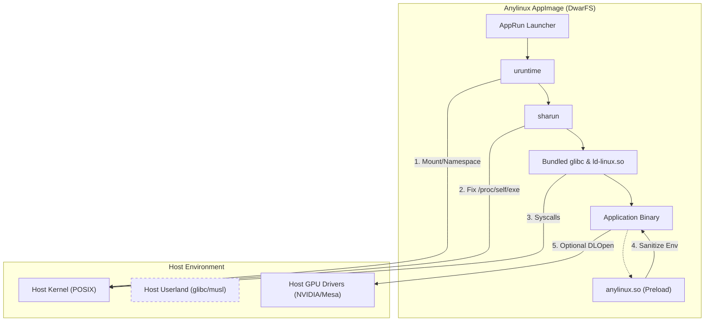
Sources: [README.md:11-15](), [FAQ.md:42-49](), [FAQ.md:63-70]()

---

### Project Goals and Philosophy

The core philosophy is "Truly 0 Requirements." By bundling the dynamic linker and utilizing `DwarFS` for high-ratio compression, the project achieves greater portability than Flatpak while using significantly less disk space—often 3.1x to 7x less storage [disk-usage-vs-flatpak.md:81-99](). The project avoids full static linking to preserve the ability to `dlopen` host GPU drivers and maintain system theme integration [FAQ.md:63-70]().

For details, see [Project Goals and Philosophy](#1.1).

Sources: [README.md:11-22](), [FAQ.md:50-71](), [disk-usage-vs-flatpak.md:81-89]()

### Supported Application Catalog

The project maintains a vast catalog of hundreds of applications, including specialized categories like "Enhanced" (optimized builds), "Recomp" (statically recompiled engines), and "Origin" (unmodified upstream sources) [README.md:41-103](). Usage and health are monitored via automated statistics that generate public-facing badges [README.md:9](), [.github/badge.json:1-6]().

For details, see [Supported Application Catalog](#1.2).

Sources: [README.md:41-103](), [.github/badge.json:1-6]()

### Tooling and Integration Map

The build process is driven by `quick-sharun.sh`, which automates dependency collection and binary patching. This is supported by a "Hall of Fame" of toolkit-specific logic (Qt, GTK, Electron) to handle the nuances of different library ecosystems [HALL-OF-FAME.md:8-82]().

**Code Entity Mapping**
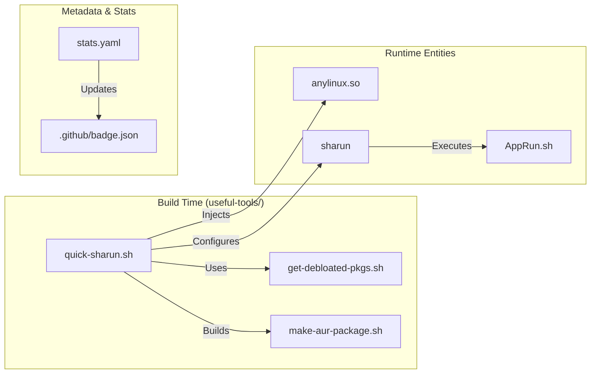
Sources: [HALL-OF-FAME.md:43-49](), [HALL-OF-FAME.md:77-82](), [.github/badge.json:1-6]()

---

## Wiki Map

*   **[Core Architecture](#2)**: Deep dive into `sharun`, `uruntime`, and the `AppRun` execution chain.
*   **[Build Tooling](#3)**: Documentation for `quick-sharun.sh`, package debloating, and AUR automation.
*   **[Runtime Libraries](#4)**: Details on `anylinux.so` and `gtk-class-fix.so` shims.
*   **[Hook System](#5)**: How the AppImage adapts to host hardware (Vulkan, NVIDIA) and desktop environments.
*   **[Demo AppImages and Examples](#6)**: Reference implementations for various toolkits.
*   **[CI/CD and GitHub Infrastructure](#7)**: Automation for releases and download tracking.

---

# Page: Project Goals and Philosophy

# Project Goals and Philosophy

<details>
<summary>Relevant source files</summary>

The following files were used as context for generating this wiki page:

- [FAQ.md](FAQ.md)
- [HOW-TO-MAKE-THESE.md](HOW-TO-MAKE-THESE.md)
- [README.md](README.md)
- [disk-usage-vs-flatpak.md](disk-usage-vs-flatpak.md)

</details>


The **Anylinux-AppImages** project aims to provide truly portable Linux applications that function across the entire spectrum of the Linux ecosystem. Unlike traditional AppImages that rely on host-provided core libraries, Anylinux AppImages are self-contained units that bundle their own runtime environment, including the C library (glibc) and the dynamic linker.

## The Portability Goal: "Any Linux"

The project defines "Any Linux" as the ability to run on distributions ranging from extremely old releases (e.g., Ubuntu 12.04) to modern, non-standard environments like NixOS or musl-based distributions (e.g., Alpine Linux) without requiring FHS-compliant wrappers or system-level modifications [FAQ.md:6-37]().

### The Problem with Traditional Approaches
Traditional AppImages and container-based formats (Flatpak/Snap) face several limitations:
*   **Glibc Dependency:** Standard AppImages typically rely on the host `glibc`. If the host's version is older than the one used during the AppImage build, the application fails to launch [README.md:19-22]().
*   **Environment Constraints:** Flatpak requires `bubblewrap` and `FUSE` [README.md:20](), while Snap requires `systemd` [README.md:21]().
*   **FHS Reliance:** Many portable formats assume a Filesystem Hierarchy Standard (FHS) which is absent in distributions like NixOS [FAQ.md:9-11]().

### The Anylinux Solution
Anylinux overcomes these hurdles by shipping a private `ld-linux.so` and `glibc` [FAQ.md:42-49](). Because it is impossible to have a relative dynamic linker path hardcoded in an ELF executable's `PT_INTERP` segment, the project utilizes `sharun` to execute the dynamic linker first, which then loads the target binary [FAQ.md:45-47]().

| Feature | Anylinux AppImage | Traditional AppImage | Flatpak |
| :--- | :--- | :--- | :--- |
| **Libc** | Bundled (glibc) | Host-dependent | Runtime-dependent |
| **FUSE** | Optional (fallback to NS) | Required (for mounting) | Required |
| **Namespaces** | Fallback supported | No native fallback | Required |
| **Extract & Run** | Automatic last resort | Manual intervention | N/A |

**Sources:** [README.md:17-22](), [FAQ.md:42-49](), [HOW-TO-MAKE-THESE.md:20-22]()

## Core Philosophy: Efficiency and Compatibility

### Bundling glibc vs. musl
While `musl` is often praised for its small size, Anylinux prioritizes `glibc` for three technical reasons:
1.  **NVIDIA Compatibility:** The proprietary NVIDIA driver links against `glibc`. Using `musl` would break hardware acceleration for these users [FAQ.md:52]().
2.  **Symbol Availability:** `glibc` allows `dlopen` of host libraries (like GTK themes) even if the host uses `musl`. The reverse is often impossible due to missing symbols in `musl` [FAQ.md:55]().
3.  **Performance:** `glibc` allocators generally outperform `musl` in complex desktop applications [FAQ.md:53]().

### DwarFS vs. SquashFS
Standard AppImages use SquashFS. Anylinux utilizes **DwarFS**, which offers significantly higher compression ratios and faster access times [README.md:11](). When combined with `OPTIMIZE_LAUNCH=1`, the build process creates a DwarFS profile (similar to Profile Guided Optimization) to minimize startup latency [HOW-TO-MAKE-THESE.md:156]().

### Size Comparison: The "Flatpak-Hell" Avoidance
Anylinux AppImages are significantly smaller than Flatpak equivalents. A comparison of 20 applications showed AppImages using **2.0 GiB** compared to Flatpak's **6.27 GiB** [disk-usage-vs-flatpak.md:83-87](). This efficiency stems from:
*   **Debloated Packages:** Using `get-debloated-pkgs.sh` to install optimized variants of MESA, Qt, and GTK [HOW-TO-MAKE-THESE.md:107-120]().
*   **No Runtime Duplication:** Avoiding "Flatpak-hell," where multiple versions of the same runtime are stored to satisfy different application requirements [disk-usage-vs-flatpak.md:99]().

**Sources:** [FAQ.md:50-62](), [disk-usage-vs-flatpak.md:81-101](), [HOW-TO-MAKE-THESE.md:156]()

## Data Flow and Execution Architecture

The transition from a standard system binary to a portable Anylinux execution involves a specific chain of shims and environment sanitization.

### Launch Logic Diagram
This diagram illustrates how `uruntime` and `sharun` bridge the gap between the host and the bundled environment.

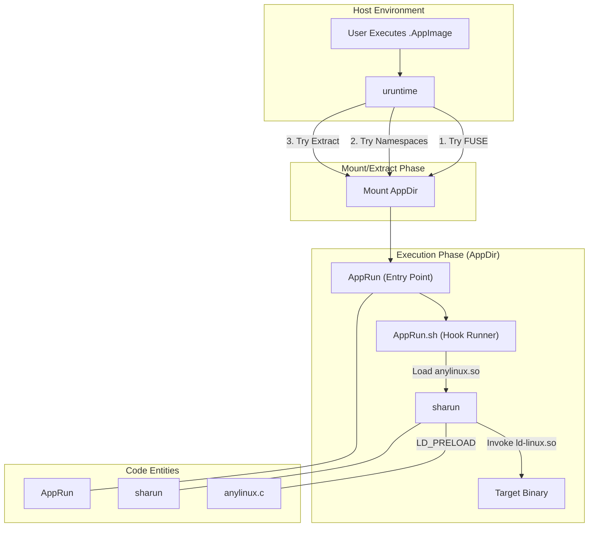
**Sources:** [README.md:13-15](), [HOW-TO-MAKE-THESE.md:140-146](), [FAQ.md:47]()

### Build Pipeline: Natural Language to Code Entity
The build process transforms a system-installed application into the portable structure.

| Step | Goal | Code Entity / Script |
| :--- | :--- | :--- |
| **Preparation** | Install minimal dependencies | `get-debloated-pkgs.sh` [HOW-TO-MAKE-THESE.md:110]() |
| **Collection** | Trace and copy libraries | `quick-sharun.sh` [HOW-TO-MAKE-THESE.md:60]() |
| **Sanitization** | Intercept `execve` calls | `anylinux.c` [HOW-TO-MAKE-THESE.md:154]() |
| **Packaging** | Compress into DwarFS image | `appimagetool` (DwarFS variant) [README.md:31]() |

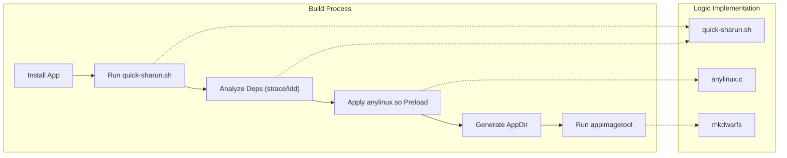
**Sources:** [HOW-TO-MAKE-THESE.md:55-69](), [HOW-TO-MAKE-THESE.md:107-120](), [README.md:11-13]()

---

# Page: Supported Application Catalog

# Supported Application Catalog

<details>
<summary>Relevant source files</summary>

The following files were used as context for generating this wiki page:

- [.github/badge.json](.github/badge.json)
- [.github/outdated.repos](.github/outdated.repos)
- [.github/repos.stats](.github/repos.stats)
- [.github/repos.stats.bytotal](.github/repos.stats.bytotal)
- [.github/repos.stats.diff](.github/repos.stats.diff)

</details>


This page documents the breadth of applications maintained within the Anylinux-AppImages ecosystem. It covers the categorization of packages, the automated tracking of download metrics, and the lifecycle management of repositories.

## Application Naming Conventions

The project categorizes its catalog using specific suffixes that denote the level of modification or the nature of the source binary. These conventions help users and developers understand the "portability tier" of a given package.

| Suffix | Description | Example |
| :--- | :--- | :--- |
| `-AppImage` | Standard Anylinux packaging of an application, typically using the `quick-sharun.sh` pipeline to bundle all dependencies including `glibc`. | `12to11-AppImage` [`.github/repos.stats:1`]() |
| `-AppImage-Enhanced` | Packages that include additional features, plugins, or specific performance optimizations (e.g., PGO/LTO) not found in upstream releases. | `86box-AppImage-Enhanced` [`.github/repos.stats:3`]() |
| `-Origin-AppImage` | Packages that track the official "original" source closely, often used for browsers or tools where minimal modification is desired beyond portability. | `Brave-Origin-AppImage` [`.github/repos.stats:33`]() |
| `Recomp-AppImage` | Specifically used for static recompilations of older software or games, often involving reverse-engineered codebases. | `BanjoRecomp-AppImage` [`.github/repos.stats:26`]() |

## Catalog Statistics and Tracking

The project maintains real-time tracking of the application catalog's popularity and growth. This data is stored in the `.github/` directory and is updated via automated CI workflows.

### Data Structures
*   **`repos.stats`**: A flat list of every tracked application and its cumulative download count across all releases. [`.github/repos.stats:1-444`]()
*   **`repos.stats.bytotal`**: The same data sorted by total popularity. As of the current snapshot, `Citron-AppImage` (201,034 downloads) and `ghostty-appimage` (100,986 downloads) represent the highest volume. [`.github/repos.stats.bytotal:1-2`]()
*   **`repos.stats.diff`**: Tracks the delta (growth) in downloads between statistic collection intervals, allowing the identification of trending applications. [`.github/repos.stats.diff:1-257`]()

### Statistics Data Flow
The following diagram illustrates how raw GitHub API data is transformed into the tracked statistics files.

**Diagram: Download Statistics Pipeline**
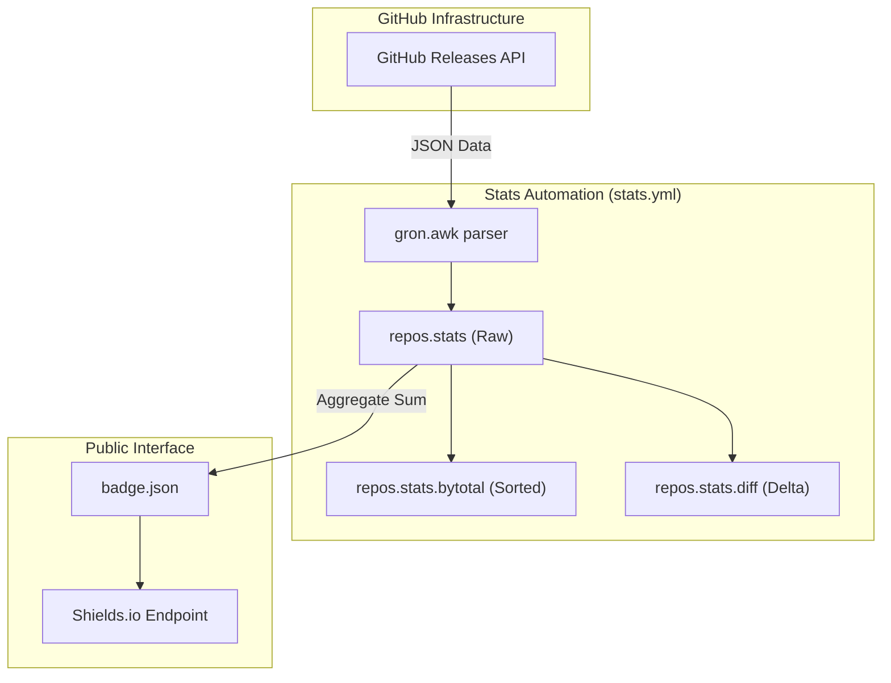
*Sources: [`.github/repos.stats`](), [`.github/repos.stats.bytotal`](), [`.github/repos.stats.diff`](), [`.github/badge.json`]()*

## The `badge.json` Implementation

The aggregate popularity of the entire Anylinux-AppImages ecosystem is surfaced via a Shields.io compatible JSON endpoint. This file is updated by the `stats.yaml` workflow and contains the sum of all values found in `repos.stats`.

*   **Schema**: Follows the Shields.io endpoint badge schema version 1. [`.github/badge.json:2`]()
*   **Label**: Set to "Downloads". [`.github/badge.json:3`]()
*   **Message**: Contains the string representation of total downloads (e.g., "1010571"). [`.github/badge.json:4`]()

## Repository Lifecycle: `outdated.repos`

To maintain the health of the catalog, the project uses an automated lifecycle management system. Repositories that are no longer receiving updates, have been superseded, or are tracking deprecated upstream projects are added to the `outdated.repos` file.

### Lifecycle Flow
1.  **Identification**: A repository is identified as deprecated or unmaintained.
2.  **Flagging**: The repository name is added to `.github/outdated.repos`. [`.github/outdated.repos:1-44`]()
3.  **Automation**: The `outdated.yml` workflow parses this file to perform maintenance tasks, such as updating the repository description with a deprecation notice or archiving the repository.

**Diagram: Repository Lifecycle Logic**
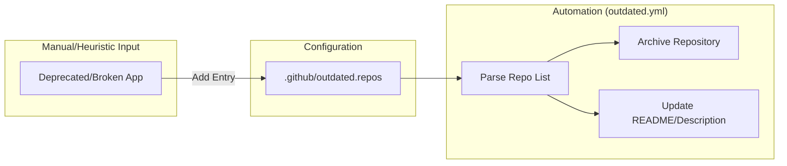
*Sources: [`.github/outdated.repos:1-45`]()*

### Notable Outdated Entries
Entries in this list include high-traffic but discontinued projects such as `Citron-AppImage` [`.github/outdated.repos:5`]() and `Torzu-AppImage` [`.github/outdated.repos:31`](), ensuring users are aware of their status despite their high download counts in `repos.stats.bytotal`.

Sources:
- [`.github/badge.json:1-7`]()
- [`.github/repos.stats:1-239`]()
- [`.github/repos.stats.bytotal:1-239`]()
- [`.github/repos.stats.diff:1-257`]()
- [`.github/outdated.repos:1-45`]()

---

# Page: Core Architecture

# Core Architecture

<details>
<summary>Relevant source files</summary>

The following files were used as context for generating this wiki page:

- [FAQ.md](FAQ.md)
- [HOW-TO-MAKE-THESE.md](HOW-TO-MAKE-THESE.md)
- [README.md](README.md)

</details>


The Anylinux AppImage architecture is designed to achieve "zero-dependency" portability across the Linux ecosystem. Unlike traditional AppImages that rely on the host system's `glibc` and a standard Filesystem Hierarchy Standard (FHS) layout, Anylinux AppImages bundle the entire execution stack—including the dynamic linker (`ld-linux.so`), the C library (`glibc`), and all hardware-acceleration drivers—into a single, highly compressed DwarFS image.

## The Execution Stack

The life cycle of an Anylinux AppImage involves a multi-stage handoff from the host kernel to the bundled environment. This process ensures that the application never "sees" the host's incompatible libraries, preventing symbol collisions and version mismatches.

### 1. The Runtime (`uruntime`)
When the AppImage is executed, the `uruntime` header (a specialized version of [uruntime](https://github.com/VHSgunzo/uruntime)) is the first code to run. It attempts to mount the internal DwarFS filesystem using three fallback strategies:
1.  **FUSE**: The preferred method for performance and integration.
2.  **User Namespaces**: If FUSE is unavailable (e.g., in some container environments), it uses mount namespaces.
3.  **Extraction**: If both FUSE and namespaces fail, it extracts the contents to `TMPDIR` and executes from disk.

For details, see [The AppRun Execution Chain](#2.1).

### 2. The Entry Point (`AppRun`)
Once mounted, the runtime executes the `AppRun` binary at the root of the AppDir. In Anylinux AppImages, this is typically a symlink to `bin/sharun`.

### 3. The Orchestrator (`sharun`)
`sharun` is the core of the "Anylinux" portability layer. It performs several critical tasks:
*   **Fixing `/proc/self/exe`**: It ensures that applications querying their own executable path receive the correct path inside the bundle, rather than the path to the dynamic linker.
*   **Environment Setup**: It reads the `.env` file to set `LD_LIBRARY_PATH` and other essential variables.
*   **Library Redirection**: It uses the `--library-path` trick to force the bundled `ld-linux.so` to load libraries from the bundle instead of the host.

### 4. The Shell Wrapper (`AppRun.sh`) and Hooks
`sharun` eventually calls `AppRun.sh`, which sources any configured hooks (e.g., `vulkan-check.hook`, `self-updater.hook`). These hooks handle hardware-specific edge cases, such as NVIDIA driver detection or Wayland fallbacks.

**System Handoff Diagram**

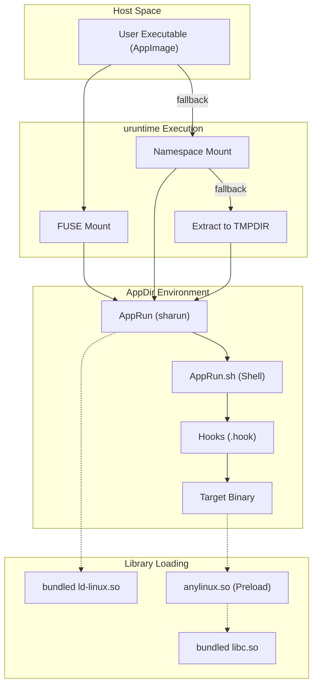
**Sources:**
*   `uruntime` capabilities and fallbacks: [README.md:13-22]()
*   `sharun` role and `/proc/self/exe` fix: [FAQ.md:42-47]()
*   Hook sourcing: [HOW-TO-MAKE-THESE.md:138-146]()

---

## Filesystem and Compression

Anylinux AppImages depart from the traditional SquashFS format in favor of **DwarFS**. DwarFS provides significantly higher compression ratios and faster access times by utilizing clustering and dictionary-based compression.

*   **DwarFS**: Replaces SquashFS to reduce size (often 50% smaller than standard AppImages) and improve metadata performance.
*   **Launch Optimization**: By using `OPTIMIZE_LAUNCH=1`, the build process profiles the application's access patterns to create a DwarFS image optimized for startup speed, similar to Profile Guided Optimization (PGO).

For details, see [AppImage Filesystem: DwarFS and Compression](#2.4).

**Sources:**
*   DwarFS benefits: [README.md:11-11]()
*   Optimization flag: [HOW-TO-MAKE-THESE.md:156-156]()

---

## Build Pipeline Architecture

The construction of an AppImage is handled by `quick-sharun.sh`, which automates the collection of dependencies that are otherwise difficult to track.

### Dependency Collection
The pipeline uses a dual-phase approach:
1.  **Static Analysis**: Using `ldd` and `patchelf` to map basic shared library requirements.
2.  **Dynamic Tracing**: Using `strace` (enabled via `STRACE_MODE=1`) to identify libraries loaded via `dlopen()` at runtime (e.g., graphics drivers, icon themes, or plugins).

### Toolkit Logic
The script includes specific heuristics for major toolkits (Qt, GTK, Electron). It automatically detects if an application requires `DEPLOY_OPENGL` or `DEPLOY_VULKAN` and bundles the necessary Mesa or debloated provider libraries.

For details, see [Dependency Collection and Bundling](#2.2) and [Toolkit-Specific Deployment Logic](#2.3).

**Code Entity Mapping: Build Pipeline**

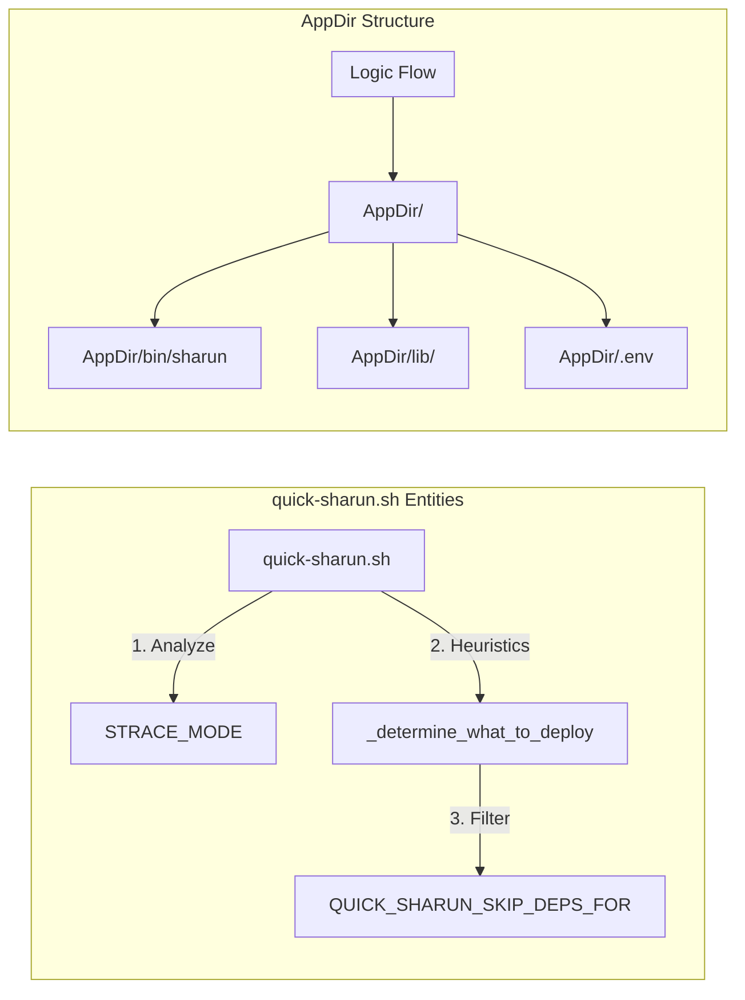
**Sources:**
*   Build workflow: [HOW-TO-MAKE-THESE.md:55-69]()
*   Environment variables: [HOW-TO-MAKE-THESE.md:130-160]()
*   Debloated packages integration: [HOW-TO-MAKE-THESE.md:107-120]()

---

## Portability Shims (`anylinux.so`)

To maintain isolation from the host, the project uses a preload library called `anylinux.so` (controlled by the `ANYLINUX_LIB=1` flag). This library intercepts system calls to prevent the application from accidentally loading host libraries or leaking environment variables that might cause the application to crash on foreign distributions.

For details, see [anylinux.so: Environment Sanitizer](#4.1).

**Sources:**
*   `ANYLINUX_LIB` flag: [HOW-TO-MAKE-THESE.md:154-154]()
*   Portability philosophy: [FAQ.md:50-58]()

---

# Page: The AppRun Execution Chain

# The AppRun Execution Chain

<details>
<summary>Relevant source files</summary>

The following files were used as context for generating this wiki page:

- [FAQ.md](FAQ.md)
- [HOW-TO-MAKE-THESE.md](HOW-TO-MAKE-THESE.md)
- [README.md](README.md)
- [useful-tools/quick-sharun.sh](useful-tools/quick-sharun.sh)
- [useful-tools/uruntime2appimage.sh](useful-tools/uruntime2appimage.sh)

</details>


This page provides a detailed technical walkthrough of the execution sequence for an Anylinux AppImage. Unlike traditional AppImages that rely on the host system's `glibc` and FHS layout, Anylinux AppImages utilize a multi-stage boot process involving `uruntime` for filesystem mounting and `sharun` for environment orchestration and `glibc` isolation.

## Execution Overview

The launch process follows a strict chain of responsibility to ensure the application runs in a hermetic environment while maintaining compatibility with host-side hardware drivers (e.g., NVIDIA).

### Launch Sequence Diagram: Code Entity Space

The following diagram maps the logical launch phases to the specific scripts and binaries responsible for each step.

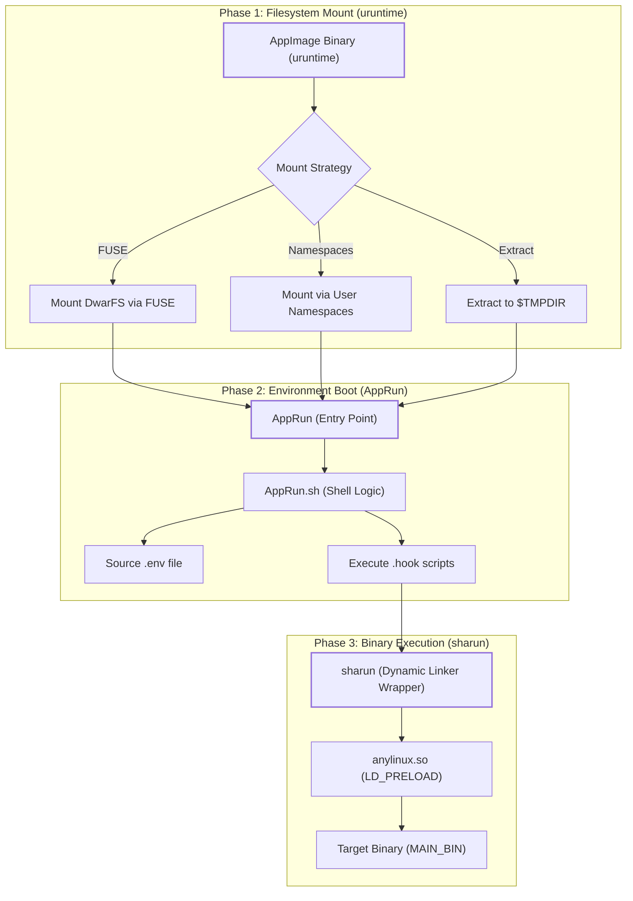
**Sources:** `README.md:13-22`[], `useful-tools/quick-sharun.sh:8-12`[]

---

## 1. The uruntime Mount Strategies

The entry point of the AppImage is the `uruntime` header. It is designed to be "zero-requirement," falling back through three distinct strategies to access the internal DwarFS filesystem:

1.  **FUSE:** The primary method. It attempts to mount the internal DwarFS image using the host's FUSE kernel module.
2.  **Namespaces:** If FUSE is unavailable (e.g., in some CI environments or locked-down containers), `uruntime` attempts to use Linux user namespaces to mount the image.
3.  **Extract:** If both FUSE and namespaces fail, the runtime automatically extracts the contents to `TMPDIR` and executes from there, performing a post-run cleanup.

**Sources:** `README.md:15-22`[], `useful-tools/uruntime2appimage.sh:30-31`[]

---

## 2. The AppRun and AppRun.sh Sequence

Once the filesystem is mounted, the runtime executes `AppDir/AppRun`. In Anylinux AppImages, `AppRun` typically acts as a small dispatcher that invokes `AppRun.sh`.

### The .env File
`quick-sharun.sh` generates a `.env` file at the root of the `AppDir`. This file contains metadata required for the launch, such as the `MAIN_BIN` path and deployment flags.
*   **Path:** `[useful-tools/quick-sharun.sh:42]()`
*   **Role:** Defines the application's entry point and initial environment variables before hooks are processed.

### The Hook System
`AppRun.sh` iterates through and sources scripts located in `bin/*.hook`. These hooks handle runtime adjustments such as:
*   **Hardware Compatibility:** Checking for Vulkan/OpenGL support.
*   **System Integration:** Handling AppArmor namespace restrictions (e.g., `fix-namespaces.hook`).
*   **Updates:** Invoking the `self-updater.hook`.

**Sources:** `useful-tools/quick-sharun.sh:8-10`[], `HOW-TO-MAKE-THESE.md:140-146`[]

---

## 3. sharun: The Linker Orchestrator

The final step of the shell sequence is calling `sharun`. This utility is critical for Anylinux portability because it bypasses the host's `ld-linux.so`.

### The /proc/self/exe Problem
Standard Linux binaries expect `/proc/self/exe` to point to the actual application binary. When a binary is launched via a bundled dynamic linker (`ld-linux.so.2 path/to/bin`), `/proc/self/exe` incorrectly points to the linker. `sharun` fixes this by using `prctl` or similar shims to ensure the process correctly identifies itself.

### The --library-path Trick
`sharun` executes the bundled dynamic linker and explicitly sets the `--library-path` to include the AppImage's internal `lib` directories. This ensures that the application always prefers bundled libraries (including the bundled `glibc`) over host libraries, preventing "version GLIBC_X.Y not found" errors.

**Sources:** `FAQ.md:42-49`[], `useful-tools/quick-sharun.sh:49`[]

---

## 4. Execution Data Flow

The following table describes the transition of environment variables and control throughout the execution chain:

| Component | Responsibility | Key File Entities |
| :--- | :--- | :--- |
| **uruntime** | Filesystem Access | `uruntime-appimage-dwarfs` |
| **AppRun.sh** | Environment Setup | `AppRun`, `.env`, `*.hook` |
| **sharun** | Linker Redirection | `shared/bin/sharun` |
| **anylinux.so** | Env Sanitization | `lib/anylinux.so` |
| **Target** | Application Logic | `bin/[APP_NAME]` |

### Implementation Detail: anylinux.so
If `ANYLINUX_LIB=1` is set, `anylinux.so` is added to `LD_PRELOAD`. This library intercepts `execve` and `posix_spawn` calls to ensure that child processes spawned by the AppImage do not inherit the bundled library paths, which would cause host binaries (like `xdg-open`) to crash.

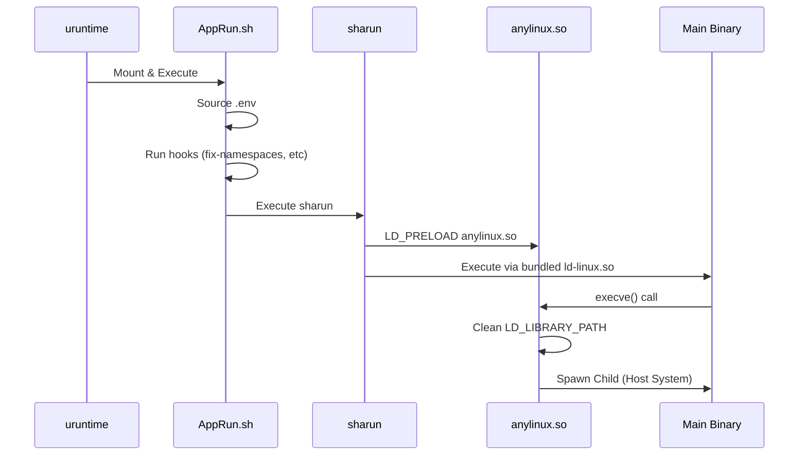

**Sources:** `useful-tools/quick-sharun.sh:60-61`[], `HOW-TO-MAKE-THESE.md:154-155`[]

---

## 5. Summary of Key Variables

| Variable | Source | Purpose |
| :--- | :--- | :--- |
| `APPDIR` | `quick-sharun.sh:41` | Root directory of the mounted AppImage. |
| `MAIN_BIN` | `quick-sharun.sh:47` | The target executable to be launched by `sharun`. |
| `ADD_HOOKS` | `quick-sharun.sh:8` | List of hook scripts to include in the execution chain. |
| `STRACE_MODE` | `quick-sharun.sh:71` | Enables library tracing during build to populate the `lib` directory. |

**Sources:** `useful-tools/quick-sharun.sh:41-71`[]

---

# Page: Dependency Collection and Bundling

# Dependency Collection and Bundling

<details>
<summary>Relevant source files</summary>

The following files were used as context for generating this wiki page:

- [useful-tools/quick-sharun.sh](useful-tools/quick-sharun.sh)
- [useful-tools/uruntime2appimage.sh](useful-tools/uruntime2appimage.sh)

</details>


The dependency collection pipeline in `quick-sharun.sh` is designed to ensure maximum portability by bundling not just application-level libraries, but also the entire execution environment including `glibc` and the dynamic linker (`ld-linux`). The process uses a dual-phase approach: static analysis to build a base set of dependencies and dynamic tracing to capture libraries loaded at runtime via `dlopen`.

## Dual-Phase Collection Pipeline

The pipeline operates in two distinct stages to ensure that both hard-linked and dynamically loaded libraries are captured within the `AppDir`.

### Phase 1: Static Analysis
Static analysis relies on `ldd` and `patchelf` to resolve the immediate shared library dependencies of ELF binaries.
*   **Recursive `ldd`**: The function `_lib4bin_ldd_libs` parses the output of `ldd` to identify absolute paths of required libraries [useful-tools/quick-sharun.sh:177-179]().
*   **Filtering**: The pipeline respects the `QUICK_SHARUN_SKIP_DEPS_FOR` variable to prevent "dependency bloat." For instance, `libqgtk3.so` is skipped by default to prevent Qt applications from unnecessarily pulling in the entire GTK stack [useful-tools/quick-sharun.sh:90-97]().

### Phase 2: Dynamic Tracing (STRACE_MODE)
Many modern applications (e.g., Electron, Qt, GStreamer) load plugins and drivers at runtime using `dlopen()`. These are invisible to `ldd`.
*   **Implementation**: If `STRACE_MODE` is enabled (default is 1), the script executes the target binary using `strace` [useful-tools/quick-sharun.sh:71-72]().
*   **Trace Capture**: It monitors `open`, `openat`, and `execve` system calls to identify files accessed during a short execution window (defined by `STRACE_TIME`) [useful-tools/quick-sharun.sh:72]().
*   **LD_DEBUG**: In addition to `strace`, the pipeline leverages `LD_DEBUG=libs` to log every library the dynamic linker attempts to load.

### Code Entity Mapping: Collection Logic
The following diagram maps the logical collection phases to the specific shell functions and variables in `quick-sharun.sh`.

**Dependency Discovery Workflow**
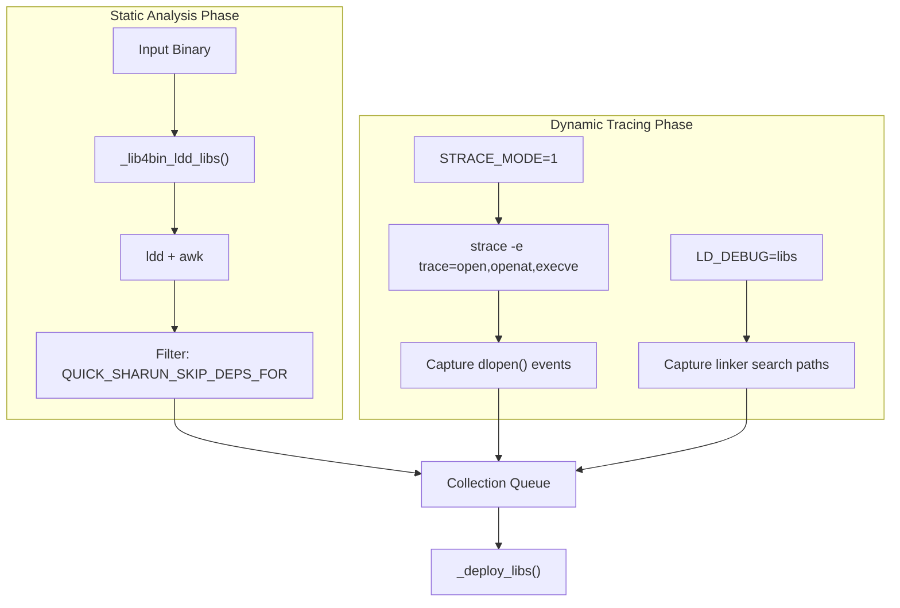
**Sources:** [useful-tools/quick-sharun.sh:71-72](), [useful-tools/quick-sharun.sh:94-97](), [useful-tools/quick-sharun.sh:177-179]()

---

## Binary Patching and Path Redirection

Because the bundled libraries are moved from `/usr/lib` to the `AppDir/lib` directory, hardcoded paths inside the binaries must be neutralized to ensure they don't reference the host system's filesystem.

### Hardcoded Path Neutralization
The script identifies strings containing `/usr` inside ELF binaries and replaces them with randomized placeholders.
*   **Randomization**: To avoid path length issues during string replacement, `quick-sharun.sh` generates random 3-5 character strings for `_tmp_bin`, `_tmp_lib`, and `_tmp_share` [useful-tools/quick-sharun.sh:114-117]().
*   **Patching**: These placeholders are used to overwrite hardcoded `/usr/bin`, `/usr/lib`, and `/usr/share` strings within the binaries.

### Pathmap Redirect Mechanism
To bridge the gap between the neutralized paths and the actual location inside the AppImage, a redirection mechanism is used.
*   **LD_PRELOAD_OPEN**: The script integrates `pathmap`, a utility that intercepts file-opening system calls [useful-tools/quick-sharun.sh:52]().
*   **Hook Generation**: A hook script (typically `01-path-mapping-hardcoded.hook`) is generated to map the randomized placeholders back to the `$APPDIR` at runtime [useful-tools/quick-sharun.sh:104-112]().

**Path Redirection Architecture**
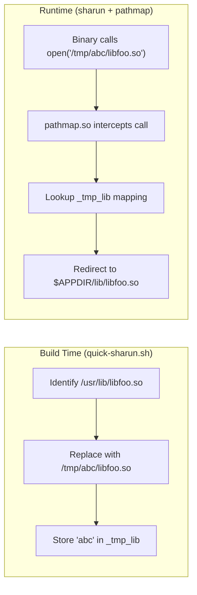
**Sources:** [useful-tools/quick-sharun.sh:52](), [useful-tools/quick-sharun.sh:104-112](), [useful-tools/quick-sharun.sh:114-117]()

---

## Deployment Configuration

The behavior of the collection pipeline is heavily influenced by environment variables that signal the presence of specific toolkits.

| Variable | Purpose |
| :--- | :--- |
| `DEPLOY_OPENGL` | Forces collection of Mesa/NVIDIA user-space drivers [useful-tools/quick-sharun.sh:6](). |
| `DEPLOY_PYTHON` | Triggers `DEPLOY_SYS_PYTHON` to bundle the system interpreter [useful-tools/quick-sharun.sh:119-121](). |
| `ANYLINUX_LIB` | Enables building and preloading `anylinux.so` for environment sanitization [useful-tools/quick-sharun.sh:60-61](). |
| `GTK_CLASS_FIX` | Bundles `gtk-class-fix.so` to handle Wayland app_id issues [useful-tools/quick-sharun.sh:62-63](). |

### Legacy Transition: uruntime2appimage
Previously, the bundling and DwarFS creation were handled by `uruntime2appimage.sh`. This script is now deprecated as its functionality—including `.DirIcon` deployment, `.desktop` file patching, and `StartupWMClass` verification—has been merged into `quick-sharun.sh` [useful-tools/uruntime2appimage.sh:10-15]().

**Sources:** [useful-tools/quick-sharun.sh:5-10](), [useful-tools/quick-sharun.sh:60-63](), [useful-tools/quick-sharun.sh:119-121](), [useful-tools/uruntime2appimage.sh:10-15](), [useful-tools/uruntime2appimage.sh:136-159]()

---

# Page: Toolkit-Specific Deployment Logic

# Toolkit-Specific Deployment Logic

<details>
<summary>Relevant source files</summary>

The following files were used as context for generating this wiki page:

- [FAQ.md](FAQ.md)
- [HALL-OF-FAME.md](HALL-OF-FAME.md)
- [README.md](README.md)
- [useful-tools/quick-sharun.sh](useful-tools/quick-sharun.sh)
- [useful-tools/uruntime2appimage.sh](useful-tools/uruntime2appimage.sh)

</details>


The Anylinux-AppImages project utilizes a heuristic-driven approach to ensure that complex software toolkits (Qt, GTK, Electron, etc.) are correctly bundled and relocatable. This logic is primarily contained within the `_determine_what_to_deploy` function in `quick-sharun.sh`, which analyzes the binaries and libraries being bundled to trigger specific deployment routines and environment configurations.

## The Deployment Heuristic Engine

The core logic resides in `quick-sharun.sh`. The script performs a multi-stage analysis: first, it checks for the presence of specific library strings in the binary's dependencies; second, it allows manual overrides via `DEPLOY_*` environment variables; and third, it applies toolkit-specific patches or configuration files (like `qt.conf`) to ensure the AppDir is self-contained.

### Logic Flow for Toolkit Detection
The following diagram illustrates how `quick-sharun.sh` maps system toolkits to internal deployment logic.

**Diagram: Toolkit Detection and Flag Mapping**
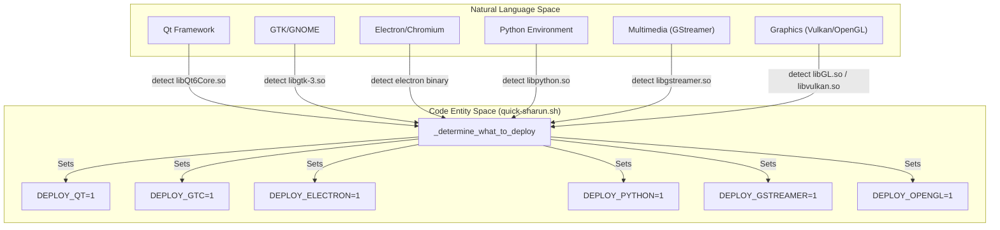
**Sources:** [useful-tools/quick-sharun.sh:4-13](), [useful-tools/quick-sharun.sh:119-121]()

---

## Toolkit-Specific Implementation Details

### Qt Framework
Qt is categorized as "Good" in the Hall of Fame. To ensure relocatability, the script generates a `qt.conf` file. This prevents the use of the `QT_PLUGIN_PATH` environment variable, which can cause issues when the AppImage launches child processes that should not inherit the bundled Qt plugins [HALL-OF-FAME.md:43-46]().

*   **Key Logic**: The script automatically sets `QT_QPA_PLATFORMTHEME=fusion` to prevent Qt from attempting to dlopen host GTK themes during the strace phase [useful-tools/quick-sharun.sh:99-100]().
*   **QML Handling**: Deploying QML is complex due to hard-to-trace `.qml` file dependencies; the current strategy is to bundle the entire QML directory when QML is detected [HALL-OF-FAME.md:47-48]().

### GTK and Electron
*   **GTK**: Often requires the `gtk-class-fix.so` shim to ensure proper window class naming on Wayland/GNOME [useful-tools/quick-sharun.sh:62-63]().
*   **Electron/Chromium**: These are highly portable but require sandbox disabling during the deployment/tracing phase to function within CI containers [useful-tools/quick-sharun.sh:140-142]().

### Multimedia and Hardware Abstraction
| Toolkit | Logic / Flags | Difficulty (Hall of Fame) |
| :--- | :--- | :--- |
| **GStreamer** | Requires `GST_PLUGIN_PATH`, `GST_PLUGIN_SYSTEM_PATH`, and `GST_PLUGIN_SCANNER`. It is difficult to trace because `gst-plugin-scanner` opens every plugin on the host [HALL-OF-FAME.md:77-81](). | **Bad** |
| **PipeWire** | Relies on `PIPEWIRE_MODULE_DIR` and `SPA_PLUGIN_DIR`. Requires `PIPEWIRE_CONFIG_DIR` if the host lacks `/usr/share/pipewire` [HALL-OF-FAME.md:37-41](). | **Good** |
| **Vulkan/OpenGL** | Handled via Mesa's ICD discovery. Relative paths are supported in `.icd` files [HALL-OF-FAME.md:33-36](). | **Excellent** |
| **ALSA** | Difficult because `alsa.conf` does not support relative paths easily, requiring `ALSA_CONFIG_PATH` overrides [HALL-OF-FAME.md:73-76](). | **Bad** |

**Sources:** [useful-tools/quick-sharun.sh:4-6](), [HALL-OF-FAME.md:16-82]()

---

## Environment Control Flags

The behavior of `_determine_what_to_deploy` can be explicitly controlled by the user through environment variables passed to `quick-sharun.sh`.

### Deployment Flags
*   `DEPLOY_OPENGL=1`: Forces bundling of Mesa/OpenGL drivers [useful-tools/quick-sharun.sh:6]().
*   `DEPLOY_PYTHON=1`: Triggers `DEPLOY_SYS_PYTHON=1` to bundle the system Python interpreter and libraries [useful-tools/quick-sharun.sh:119-121]().
*   `ANYLINUX_LIB=1`: Enables the `anylinux.so` environment sanitizer [useful-tools/quick-sharun.sh:60]().
*   `GTK_CLASS_FIX=1`: Compiles and preloads the GTK window class shim [useful-tools/quick-sharun.sh:62]().

### Debloating Flags
*   `DEBLOAT_PYTHON=1`: Triggers aggressive removal of unnecessary Python files (e.g., tests, doc) [useful-tools/quick-sharun.sh:124-128]().
*   `DEBLOAT_LOCALE=1`: Filters out non-essential locale data to save space [useful-tools/quick-sharun.sh:68]().

**Sources:** [useful-tools/quick-sharun.sh:60-72](), [useful-tools/quick-sharun.sh:119-128]()

---

## Deployment Logic Data Flow

The following diagram traces how a deployment request for a Python-based Qt application moves through the `quick-sharun.sh` logic.

**Diagram: Deployment Data Flow**
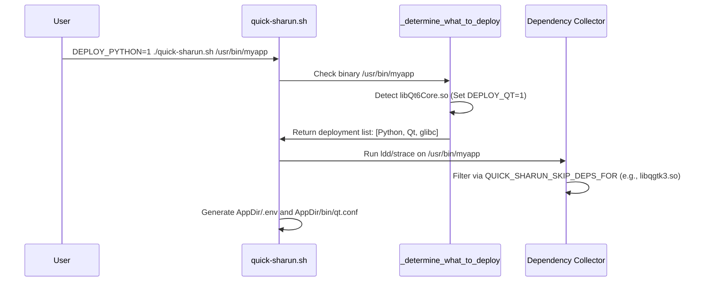
**Sources:** [useful-tools/quick-sharun.sh:94-100](), [useful-tools/quick-sharun.sh:119-121](), [HALL-OF-FAME.md:43-46]()

---

# Page: AppImage Filesystem: DwarFS and Compression

# AppImage Filesystem: DwarFS and Compression

<details>
<summary>Relevant source files</summary>

The following files were used as context for generating this wiki page:

- [FAQ.md](FAQ.md)
- [README.md](README.md)
- [useful-tools/quick-sharun.sh](useful-tools/quick-sharun.sh)
- [useful-tools/uruntime2appimage.sh](useful-tools/uruntime2appimage.sh)

</details>


This section details the filesystem architecture of Anylinux AppImages, focusing on the transition from SquashFS to DwarFS, the implementation of launch optimization through profiling, and the build-time flags that govern image creation.

## DwarFS vs. SquashFS

Traditional AppImages utilize SquashFS as their read-only compressed filesystem. Anylinux AppImages replace this with **DwarFS**, a high-compression read-only filesystem designed for massive redundancy reduction.

### Technical Advantages
1.  **Redundancy Reduction**: DwarFS excels at deduplicating similar files across the entire image, which is critical when bundling entire library sets (e.g., multiple versions of `libLLVM` or redundant locale data) [README.md:7-11]().
2.  **Performance**: Despite higher compression ratios, DwarFS provides faster access times for large metadata sets compared to SquashFS.
3.  **Flexibility**: It integrates seamlessly with `uruntime`, which supports mounting DwarFS via FUSE, or falling back to user namespaces and extraction if FUSE is unavailable [README.md:13-15]().

### Build Configuration
The compression parameters are defined in the build scripts using the `DWARFS_COMP` variable. By default, it uses high-level Zstandard compression with specific block and shard settings:
*   **Default**: `zstd:level=22 -S26 -B6` [useful-tools/uruntime2appimage.sh:22-22]().

## OPTIMIZE_LAUNCH: PGO for Filesystems

The `OPTIMIZE_LAUNCH` flag implements a mechanism similar to Profile-Guided Optimization (PGO) but for filesystem block ordering. This significantly reduces startup times by ensuring that all data required during the initial execution phase is grouped together.

### The Profiling Pipeline
When `OPTIMIZE_LAUNCH=1` is set in `quick-sharun.sh` or `uruntime2appimage.sh`, the following sequence occurs:

1.  **Trace Collection**: The application is launched within a temporary environment (often using `xvfb-run` for GUI apps) to record which files are accessed during the first few seconds of execution [useful-tools/quick-sharun.sh:55-55]().
2.  **Profile Generation**: A profile file, typically `.dwarfsprofile`, is generated containing the list of accessed files [useful-tools/uruntime2appimage.sh:26-27]().
3.  **Re-ordering**: The `mkdwarfs` tool consumes this profile to re-order the physical layout of the filesystem, placing "hot" files at the beginning of the image to minimize disk seeks and improve cache locality.

### Code Entity Map: Launch Optimization
| Code Entity | Role |
| :--- | :--- |
| `OPTIMIZE_LAUNCH` | Environment variable triggering the profiling logic [useful-tools/quick-sharun.sh:55-55](). |
| `DWARFSPROF` | The path to the generated access profile (`$APPDIR/.dwarfsprofile`) [useful-tools/uruntime2appimage.sh:26-26](). |
| `mkdwarfs` | The external tool used to build the final DwarFS image using the profile [useful-tools/uruntime2appimage.sh:24-24](). |

**Sources:**
*   [useful-tools/quick-sharun.sh:55-55]()
*   [useful-tools/uruntime2appimage.sh:22-27]()

## Build Integration and Legacy Transition

### The `OUTPUT_APPIMAGE` Flag
In `quick-sharun.sh`, the process of converting an `AppDir` into a final `.AppImage` file is controlled by the `--make-appimage` flag (which internally sets `OUTPUT_APPIMAGE=1`).

1.  **Metadata Deployment**: The script first calls `_deploy_desktop_and_icon` to ensure a valid `.desktop` file and `.DirIcon` exist in the `AppDir` [useful-tools/uruntime2appimage.sh:68-134]().
2.  **Binary Naming**: It attempts to derive the application name from the `Name=` field in the desktop entry [useful-tools/uruntime2appimage.sh:228-229]().
3.  **Image Creation**: It invokes `appimagetool` (specifically the pkgforge-dev fork) to wrap the DwarFS payload and the `uruntime` into a single executable [useful-tools/quick-sharun.sh:57-58]().

### Legacy Transition: `uruntime2appimage.sh`
Previously, the project used a standalone script `uruntime2appimage.sh` to handle the DwarFS conversion. This script is now **deprecated** and its functionality has been merged into the primary `quick-sharun.sh` pipeline [useful-tools/uruntime2appimage.sh:10-14]().

**Transition Diagram: AppDir to DwarFS AppImage**
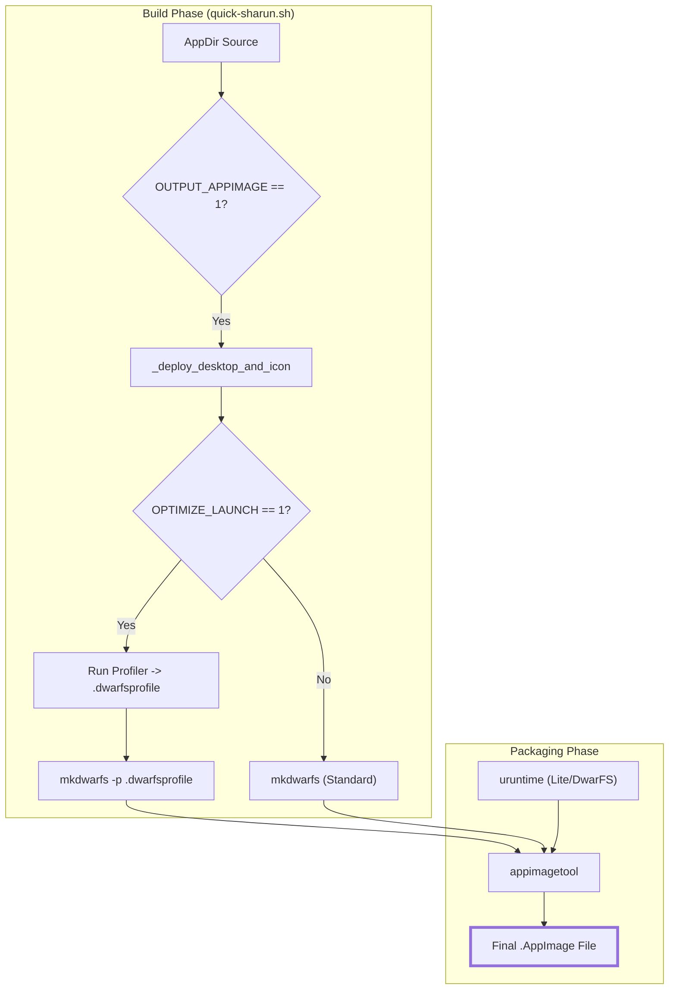
**Sources:**
*   [useful-tools/uruntime2appimage.sh:1-15]()
*   [useful-tools/uruntime2appimage.sh:68-134]()
*   [useful-tools/quick-sharun.sh:54-58]()

## Implementation Details

### Metadata Handling
The filesystem requires specific files at the root of the `AppDir` to function as a valid AppImage. The `_deploy_desktop_and_icon` function handles the following:
*   **Desktop Entries**: If missing, it generates a dummy entry based on the `MAIN_BIN` variable [useful-tools/uruntime2appimage.sh:70-89]().
*   **Icons**: It searches for icons in `share/icons/hicolor` or accepts a URL/local path via the `ICON` variable [useful-tools/uruntime2appimage.sh:108-133]().
*   **StartupWMClass**: It automatically patches the `.desktop` file to include `StartupWMClass` if it is missing, ensuring proper window grouping in taskbars [useful-tools/uruntime2appimage.sh:136-159]().

### Compression and Tooling Logic
The script dynamically downloads the necessary tooling if not present in the environment:
*   **uruntime**: The entry point that manages the DwarFS mount [useful-tools/uruntime2appimage.sh:30-30]().
*   **mkdwarfs**: The compression engine [useful-tools/uruntime2appimage.sh:31-31]().

**Code Entity Relationship: Filesystem Tools**
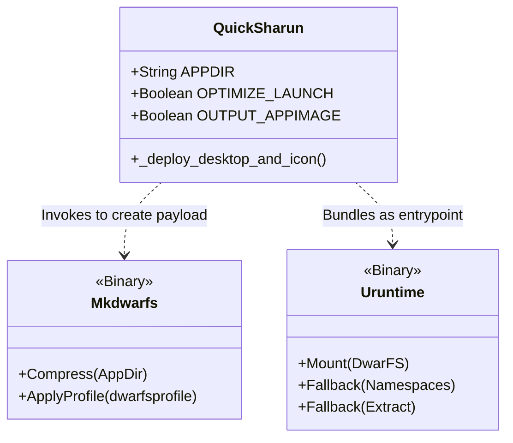

**Sources:**
*   [useful-tools/uruntime2appimage.sh:30-31]()
*   [useful-tools/uruntime2appimage.sh:136-159]()
*   [useful-tools/quick-sharun.sh:41-58]()

---

# Page: Build Tooling

# Build Tooling

<details>
<summary>Relevant source files</summary>

The following files were used as context for generating this wiki page:

- [useful-tools/get-debloated-pkgs.sh](useful-tools/get-debloated-pkgs.sh)
- [useful-tools/make-aur-package.sh](useful-tools/make-aur-package.sh)
- [useful-tools/quick-sharun.sh](useful-tools/quick-sharun.sh)
- [useful-tools/uruntime2appimage.sh](useful-tools/uruntime2appimage.sh)

</details>


The Anylinux-AppImage build ecosystem relies on a suite of specialized shell scripts located in `useful-tools/`. These tools automate the entire lifecycle of an AppImage, from building source packages in isolated Arch Linux environments to debloating dependencies and final filesystem orchestration.

### Tooling Workflow Overview

The following diagram illustrates how the primary tools interact to produce a portable AppImage.

**Build Pipeline Data Flow**
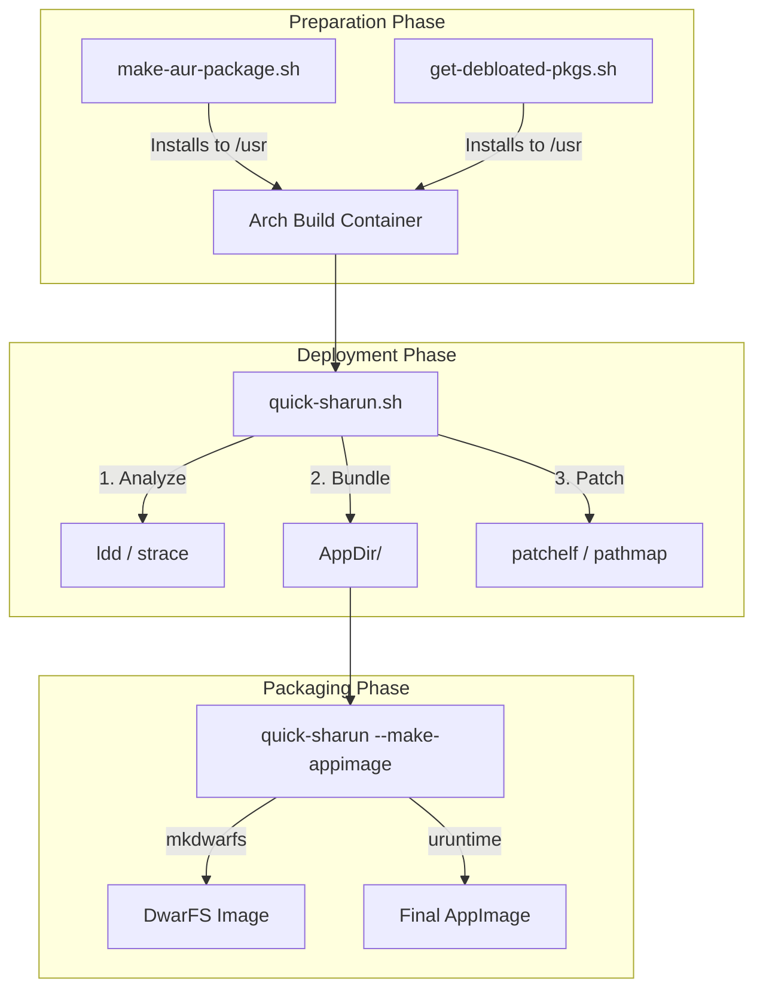
**Sources:** [useful-tools/quick-sharun.sh:1-29](), [useful-tools/make-aur-package.sh:3-7](), [useful-tools/get-debloated-pkgs.sh:3-5]()

---

### Primary Build Tools

#### [quick-sharun.sh: The Primary Build Script](#3.1)
`quick-sharun.sh` is the central orchestrator of the project. It acts as a high-level wrapper around `sharun`, automating the complex task of library deployment into a single-command interface. It handles automatic detection of toolkits like **Qt**, **GTK**, and **Electron**, and manages the collection of dynamic dependencies through both static analysis (`ldd`) and dynamic tracing (`strace`).

Key capabilities include:
*   **Environment-based Deployment**: Use flags like `DEPLOY_OPENGL=1` or `DEPLOY_PYTHON=1` to force specific stacks [useful-tools/quick-sharun.sh:6-7, 119-121]().
*   **Path Mapping**: Implements a `pathmap` mechanism to redirect hardcoded `/usr` paths within binaries to the internal AppDir structure [useful-tools/quick-sharun.sh:52, 104-112]().
*   **AppImage Creation**: Integrates `mkdwarfs` and `uruntime` to convert an `AppDir` into a finished compressed executable [useful-tools/quick-sharun.sh:55-58]().

For details, see [quick-sharun.sh: The Primary Build Script](#3.1).

#### [get-debloated-pkgs.sh: Optimized Package Installer](#3.2)
To maintain the "Anylinux" philosophy of small, portable binaries, this script fetches specialized packages from the `archlinux-pkgs-debloated` repository. These packages (variants like `mini` and `nano`) are stripped of non-essential documentation, large locales, and heavy dependencies that typically bloat standard Arch Linux packages.

Key features:
*   **Architecture Awareness**: Automatically maps system architecture to correct package suffixes (`x86_64.pkg.tar.zst` or `aarch64.pkg.tar.xz`) [useful-tools/get-debloated-pkgs.sh:153-157]().
*   **Curated Sets**: Provides `--add-common`, `--add-mesa`, and `--add-vulkan` flags to quickly install standard graphics and toolkit stacks [useful-tools/get-debloated-pkgs.sh:210-246]().
*   **Rate-Limit Handling**: Includes a GitHub API wrapper to handle authentication via `GITHUB_TOKEN` and automatic retries for rate-limited environments [useful-tools/get-debloated-pkgs.sh:91-105, 118-151]().

For details, see [get-debloated-pkgs.sh: Optimized Package Installer](#3.2).

#### [make-aur-package.sh: Arch Package Builder](#3.3)
This script automates the compilation of software within an Arch Linux container. It is designed to bridge the gap between the Arch User Repository (AUR) and the AppImage bundling process.

Technical highlights:
*   **Performance Optimization**: Patches `/etc/makepkg.conf` to enable `-O3` optimization and `x86-64-v3` architecture flags for modern CPUs [useful-tools/make-aur-package.sh:48-67]().
*   **Root Build Bypass**: Modifies `makepkg` internals (changing `EUID == 0` check to `69`) to allow building as root within CI containers [useful-tools/make-aur-package.sh:69-78]().
*   **Multi-Repo Support**: Supports fetching from official Arch repos, AUR, Chaotic-AUR, and ArchLinuxCN [useful-tools/make-aur-package.sh:90-125, 178-185]().

For details, see [make-aur-package.sh: Arch Package Builder](#3.3).

---

### Legacy and Utility Scripts

#### uruntime2appimage.sh
This script was originally used to convert an `AppDir` into a DwarFS-based AppImage using `uruntime`. While it remains in the codebase for legacy support, its functionality has been fully merged into `quick-sharun.sh --make-appimage`.

*   **Status**: Deprecated [useful-tools/uruntime2appimage.sh:10-15]().
*   **Function**: Orchestrates `mkdwarfs` and `zsyncmake` to create updateable, compressed images [useful-tools/uruntime2appimage.sh:3-5, 22-27]().

**Sources:** [useful-tools/uruntime2appimage.sh:1-31]()

---

### Entity Mapping: Script Roles

The following table maps the natural language build requirements to the specific code entities responsible for them.

| Requirement | Code Entity | File Reference |
| :--- | :--- | :--- |
| **Dependency Tracing** | `STRACE_MODE` / `_lib4bin_ldd_libs` | [useful-tools/quick-sharun.sh:71, 177-179]() |
| **Binary Patching** | `patchelf` / `pathmap` | [useful-tools/quick-sharun.sh:52, 83]() |
| **Package Debloating** | `PKG_TYPE=mini/nano` | [useful-tools/get-debloated-pkgs.sh:204-208]() |
| **AUR Integration** | `_get_aur_pkgbuild` | [useful-tools/make-aur-package.sh:132-135]() |
| **DwarFS Compression** | `DWARFS_COMP` / `mkdwarfs` | [useful-tools/uruntime2appimage.sh:22-24]() |

**Code Entity Interaction Diagram**
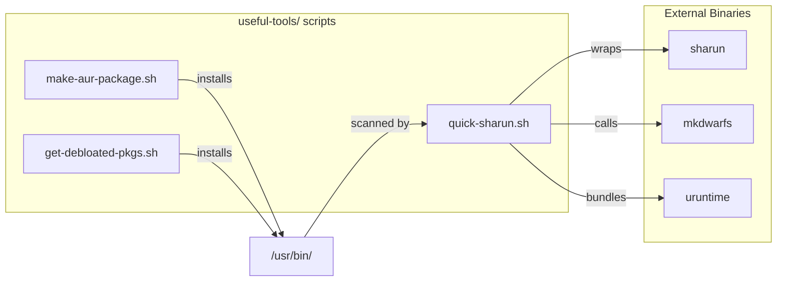
**Sources:** [useful-tools/quick-sharun.sh:49, 57-58](), [useful-tools/make-aur-package.sh:206-211](), [useful-tools/get-debloated-pkgs.sh:107-115]()

---

# Page: quick-sharun.sh: The Primary Build Script

# quick-sharun.sh: The Primary Build Script

<details>
<summary>Relevant source files</summary>

The following files were used as context for generating this wiki page:

- [HOW-TO-MAKE-THESE.md](HOW-TO-MAKE-THESE.md)
- [useful-tools/quick-sharun.sh](useful-tools/quick-sharun.sh)
- [useful-tools/uruntime2appimage.sh](useful-tools/uruntime2appimage.sh)

</details>


`quick-sharun.sh` is the primary build orchestration script for the Anylinux-AppImages project. It acts as a high-level wrapper around `sharun`, automating the complex tasks of dependency discovery, library bundling, environment configuration, and filesystem creation [useful-tools/quick-sharun.sh:1-12](). Its goal is to transform a standard application installation into a truly portable AppImage that includes its own `glibc` and runtime environment [HOW-TO-MAKE-THESE.md:65-69]().

### Technical Workflow Overview

The script operates in a multi-stage pipeline, moving from initial environment setup to the final assembly of a DwarFS-compressed AppImage.

1.  **Environment Initialization**: Sets up temporary directories, target `AppDir` structures, and downloads required external tools like `sharun`, `onelf`, and `appimagetool` [useful-tools/quick-sharun.sh:38-64]().
2.  **Dependency Discovery**: Uses a combination of static analysis (`ldd`) and dynamic tracing (`strace`) to identify all shared libraries required by the application [useful-tools/quick-sharun.sh:71-88]().
3.  **AppDir Assembly**: Populates `bin/`, `lib/`, and `shared/` directories within the `AppDir`.
4.  **Path Mapping & Patching**: Generates hooks to redirect hardcoded system paths (e.g., `/usr/share`) to internal `AppDir` locations [useful-tools/quick-sharun.sh:104-118]().
5.  **Finalization**: Packages the `AppDir` into a DwarFS-based AppImage using `uruntime` [useful-tools/quick-sharun.sh:57-58]().

#### Build Pipeline Logic
The following diagram maps the high-level build stages to the specific logic handled within the script.

**Diagram: quick-sharun.sh Execution Flow**
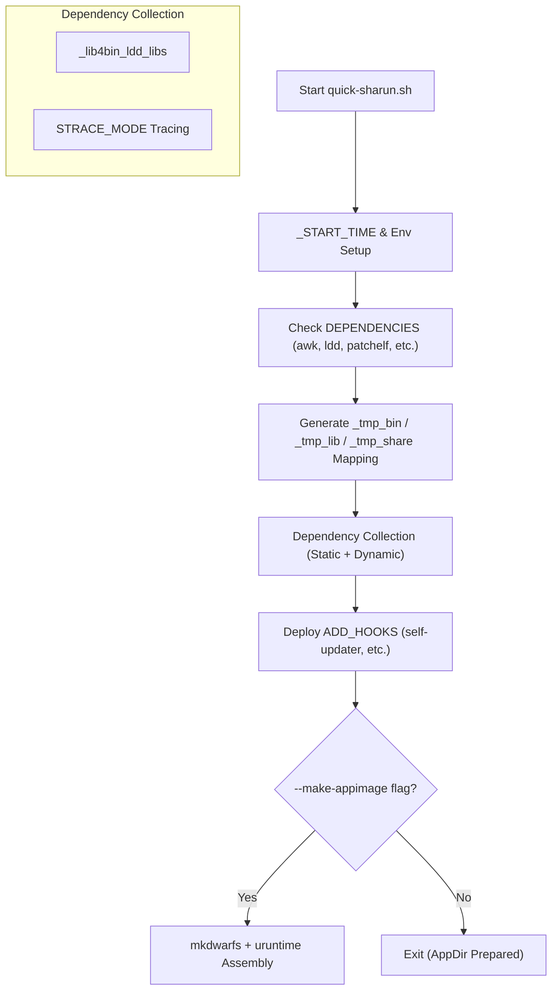
**Sources:** [useful-tools/quick-sharun.sh:30-118](), [useful-tools/quick-sharun.sh:177-179](), [useful-tools/quick-sharun.sh:71-73]()

---

### CLI Interface and Flags

`quick-sharun.sh` provides several primary flags to control the build and testing lifecycle.

| Flag | Description |
| :--- | :--- |
| `--make-appimage` | Triggers the final packaging phase. It downloads `appimagetool` and `uruntime` to create the compressed `.AppImage` file [useful-tools/quick-sharun.sh:57-58](), [HOW-TO-MAKE-THESE.md:104-105](). |
| `--test` | Runs the bundled application within the `AppDir` using `xvfb-run` to verify it launches without missing symbols in a headless environment. |
| `--simple-test` | Performs a basic execution test without X11 virtualization. |
| `--make-static-bin` | (Advanced) Attempts to create a standalone static binary representation. |

**Sources:** [useful-tools/quick-sharun.sh:208-219](), [HOW-TO-MAKE-THESE.md:63-64]()

---

### Environment Variables Reference

The script is highly configurable via environment variables, allowing developers to force specific toolkit deployments or skip problematic libraries.

#### Deployment Flags
*   `DEPLOY_OPENGL=1`: Forces bundling of Mesa/OpenGL libraries [useful-tools/quick-sharun.sh:6]().
*   `DEPLOY_VULKAN=1`: Forces bundling of Vulkan loaders and layers [HOW-TO-MAKE-THESE.md:151]().
*   `DEPLOY_PYTHON=1`: Enables bundling of the system Python environment [useful-tools/quick-sharun.sh:119-121]().
*   `ANYLINUX_LIB=1`: (Default: 1) Enables the `anylinux.so` preload shim to sanitize the environment [useful-tools/quick-sharun.sh:60-61]().
*   `GTK_CLASS_FIX=1`: Bundles a shim to fix `WM_CLASS` issues on Wayland/GNOME [useful-tools/quick-sharun.sh:62-63]().

#### Optimization & Debloating
*   `OPTIMIZE_LAUNCH=1`: Uses `mkdwarfs` profiling to create a `.dwarfsprofile`, significantly speeding up initial AppImage mount and launch [useful-tools/quick-sharun.sh:55](), [HOW-TO-MAKE-THESE.md:156]().
*   `DEBLOAT_LOCALE=1`: (Default: 1) Strips non-essential locale files to reduce bundle size [useful-tools/quick-sharun.sh:68]().
*   `STRIP=1`: (Default: 1) Strips debug symbols from all bundled binaries and libraries [HOW-TO-MAKE-THESE.md:158]().

#### Filtering
*   `QUICK_SHARUN_SKIP_DEPS_FOR`: A list of libraries to ignore during dependency resolution. By default, it includes `libqgtk3.so` to prevent Qt applications from accidentally pulling in the entire GTK stack [useful-tools/quick-sharun.sh:90-97]().

**Sources:** [useful-tools/quick-sharun.sh:1-128](), [HOW-TO-MAKE-THESE.md:130-160]()

---

### The Dependency Pipeline: Static & Dynamic

One of the most critical functions of `quick-sharun.sh` is ensuring that `dlopen()`'d libraries (which `ldd` cannot see) are captured.

#### 1. Static Analysis
The function `_lib4bin_ldd_libs` parses the output of `ldd` to find absolute paths to required libraries [useful-tools/quick-sharun.sh:177-179]().

#### 2. Dynamic Tracing (STRACE_MODE)
When `STRACE_MODE=1` (default), the script executes the target binary for a short duration (`STRACE_TIME`, default 5s) while attached to `strace` [useful-tools/quick-sharun.sh:71-72](). It monitors `open()`, `openat()`, and `access()` syscalls to identify libraries loaded at runtime [HOW-TO-MAKE-THESE.md:157]().

**Diagram: Code Entity Association (Dependency Discovery)**
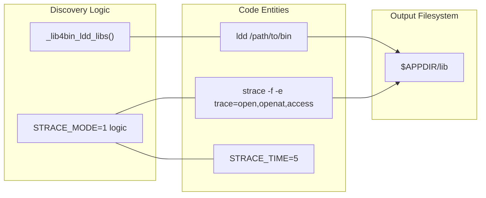
**Sources:** [useful-tools/quick-sharun.sh:71-73](), [useful-tools/quick-sharun.sh:177-179](), [HOW-TO-MAKE-THESE.md:157]()

---

### AppDir Structure and Path Mapping

`quick-sharun.sh` constructs a standardized `AppDir` layout designed to work with `sharun`.

*   **`bin/`**: Contains the main application binaries.
*   **`lib/`**: Contains all gathered `.so` files, including `glibc`.
*   **`shared/`**: Contains data files, icons, and desktop entries.
*   **`.env`**: A file generated by the script to store environment variables required by `sharun` at runtime [useful-tools/quick-sharun.sh:42]().

#### PATH_MAPPING and Hardcoded Paths
Applications often have hardcoded paths to `/usr/share` or `/usr/lib`. `quick-sharun.sh` generates a `01-path-mapping-hardcoded.hook` [useful-tools/quick-sharun.sh:104](). It uses randomized 3-5 character strings (`_tmp_bin`, `_tmp_lib`, `_tmp_share`) to create unique redirection paths, avoiding conflicts with host system paths [useful-tools/quick-sharun.sh:114-118]().

**Sources:** [useful-tools/quick-sharun.sh:41-47](), [useful-tools/quick-sharun.sh:104-118]()

---

### Hook System Integration

The `ADD_HOOKS` variable allows developers to inject scripts into the `AppRun` sequence. `quick-sharun.sh` downloads these hooks from the central repository [useful-tools/quick-sharun.sh:51]().

*   **Syntax**: `ADD_HOOKS="hook1.hook:hook2.hook"` [useful-tools/quick-sharun.sh:9]().
*   **Automatic AppRun**: If no `AppRun` exists in the target directory, using hooks will automatically trigger the download of a generic `AppRun` [useful-tools/quick-sharun.sh:10]().

**Sources:** [useful-tools/quick-sharun.sh:8-10](), [useful-tools/quick-sharun.sh:51](), [HOW-TO-MAKE-THESE.md:140-146]()

---

### Legacy Transition: uruntime2appimage.sh

Previously, the project used `uruntime2appimage.sh` to handle the final DwarFS packaging. This functionality has been fully merged into `quick-sharun.sh` via the `--make-appimage` flag [useful-tools/uruntime2appimage.sh:10-14](). 

Key features carried over from the legacy script include:
*   **Desktop/Icon Deployment**: Automated dummy generation if files are missing [useful-tools/uruntime2appimage.sh:68-106]().
*   **StartupWMClass Fix**: Automated detection and patching of `.desktop` files to ensure proper taskbar grouping [useful-tools/uruntime2appimage.sh:136-159]().
*   **DwarFS Compression Settings**: Defaulting to high-compression `zstd:level=22` [useful-tools/uruntime2appimage.sh:22]().

**Sources:** [useful-tools/uruntime2appimage.sh:1-32](), [useful-tools/uruntime2appimage.sh:68-159]()

---

# Page: get-debloated-pkgs.sh: Optimized Package Installer

# get-debloated-pkgs.sh: Optimized Package Installer

<details>
<summary>Relevant source files</summary>

The following files were used as context for generating this wiki page:

- [useful-tools/get-debloated-pkgs.sh](useful-tools/get-debloated-pkgs.sh)

</details>


The `get-debloated-pkgs.sh` script is a specialized package manager client designed to fetch and install highly optimized, reduced-size Arch Linux packages from the [archlinux-pkgs-debloated](https://github.com/pkgforge-dev/archlinux-pkgs-debloated) repository [useful-tools/get-debloated-pkgs.sh:3-5](). These packages are essential for minimizing the final footprint of Anylinux AppImages by providing "mini" and "nano" variants of heavy dependencies like Mesa, Qt, and GTK.

## Package Variants and Logic

The system distinguishes between two levels of debloating, controlled by the `--prefer-nano` flag or the `PREFER_NANO` environment variable [useful-tools/get-debloated-pkgs.sh:20-20](), [useful-tools/get-debloated-pkgs.sh:66-66]().

| Variant | Internal `PKG_TYPE` | Description |
| :--- | :--- | :--- |
| **Mini** | `mini` | Default. Strips documentation, locales, and non-essential development headers [useful-tools/get-debloated-pkgs.sh:207-208](). |
| **Nano** | `nano` | Maximum reduction. Aggressively strips components, often used for minimal CLI tools or core libraries [useful-tools/get-debloated-pkgs.sh:204-205](). |

### Dependency Groups
The script provides several high-level flags to bundle complex dependency chains automatically:

*   **`--add-common`**: Installs a curated set of libraries frequently required by modern GUI applications, including `icu-mini`, `qt6-base-mini`, `gtk3-mini`, `gtk4-mini`, and `glycin-mini`. It also implies `--add-mesa` [useful-tools/get-debloated-pkgs.sh:210-220]().
*   **`--add-mesa`**: A meta-flag that enables both OpenGL and Vulkan drivers [useful-tools/get-debloated-pkgs.sh:222-225]().
*   **`--add-opengl`**: Installs the debloated `mesa` package (variant-sensitive) [useful-tools/get-debloated-pkgs.sh:227-229]().
*   **`--add-vulkan`**: Installs architecture-specific Vulkan drivers (e.g., `vulkan-intel` for x86_64 vs `vulkan-panfrost` for aarch64) [useful-tools/get-debloated-pkgs.sh:230-246]().

### Package Resolution Logic
The following diagram illustrates how CLI flags and environment variables are resolved into a final package list.

**Title: Package Resolution and Selection Flow**
```mermaid
graph TD
    subgraph "Input Processing"
        START["Start"] --> FLAGS["Parse CLI Flags & Env Vars"]
        FLAGS --> ARCH_MAP["Identify Architecture: uname -m"]
    end

    subgraph "Expansion Logic"
        ARCH_MAP --> COMMON{{"--add-common?"}}
        COMMON -- "Yes" --> ADD_COMMON["Add icu, qt6, gtk3/4, glycin"]
        ADD_COMMON --> MESA_SET["Set ADD_MESA=1"]
        COMMON -- "No" --> MESA_SET
        
        MESA_SET --> MESA_CHECK{{"ADD_MESA?"}}
        MESA_CHECK -- "Yes" --> GL_VK["Set ADD_OPENGL=1, ADD_VULKAN=1"]
        MESA_CHECK -- "No" --> GL_VK_CHECK
        
        GL_VK --> GL_VK_CHECK{{"OpenGL/Vulkan Flags?"}}
        
        GL_VK_CHECK --> VULKAN_ARCH{{"Vulkan Arch Mapping"}}
        VULKAN_ARCH -- "x86_64" --> VK_X86["intel, radeon, nouveau, virtio"]
        VULKAN_ARCH -- "aarch64" --> VK_ARM["panfrost, freedreno, broadcom, asahi, powervr, radeon, nouveau, virtio"]
    end

    subgraph "Variant Selection"
        VK_X86 --> VAR_TYPE{{"PREFER_NANO?"}}
        VK_ARM --> VAR_TYPE
        VAR_TYPE -- "1" --> SUFFIX_NANO["PKG_TYPE = nano"]
        VAR_TYPE -- "0" --> SUFFIX_MINI["PKG_TYPE = mini"]
    end

    SUFFIX_NANO --> FINAL_LIST["Append manual ADD_PACKAGES"]
    SUFFIX_MINI --> FINAL_LIST
```
**Sources:** [useful-tools/get-debloated-pkgs.sh:13-13](), [useful-tools/get-debloated-pkgs.sh:159-202](), [useful-tools/get-debloated-pkgs.sh:204-248]()

## Architecture Mapping and GitHub Integration

The script dynamically maps the system architecture to the specific package extensions used in the `archlinux-pkgs-debloated` releases [useful-tools/get-debloated-pkgs.sh:153-157]():
*   **x86_64**: Uses `.x86_64.pkg.tar.zst`
*   **aarch64**: Uses `.aarch64.pkg.tar.xz`

### Rate-Limit Handling and GITHUB_TOKEN
To prevent CI failures due to GitHub API rate limits, the script implements a sophisticated download wrapper. If `GITHUB_TOKEN` is present, it generates a temporary wrapper script `.wget-curl-wrapper.sh` [useful-tools/get-debloated-pkgs.sh:118-151]().

This wrapper:
1.  Detects if the target URL is a GitHub domain [useful-tools/get-debloated-pkgs.sh:122-126]().
2.  Injects the `Authorization: Bearer $GITHUB_TOKEN` and `Accept: application/vnd.github+json` headers [useful-tools/get-debloated-pkgs.sh:132-134](), [useful-tools/get-debloated-pkgs.sh:141-143]().
3.  Implements a retry loop in the `_download()` function that sleeps for 10 minutes (600 seconds) if an `HTTP 403` (Rate Limit) error is encountered [useful-tools/get-debloated-pkgs.sh:90-105]().

**Title: GitHub API and Download Lifecycle**
```mermaid
sequenceDiagram
    participant S as get-debloated-pkgs.sh
    participant W as .wget-curl-wrapper.sh
    participant G as GitHub API / Releases

    S->>G: Fetch latest release JSON (SOURCE)
    Note over S,G: Uses sed/grep to parse pkg.tar URLs
    S->>S: Filter URLs by SUFFIX (arch)
    
    loop For each Package
        S->>W: _download(pkg_url)
        W->>G: GET pkg_url (with Auth Headers)
        alt Success
            G-->>W: 200 OK (Binary Data)
        else Rate Limited (403)
            G-->>W: 403 Forbidden
            W-->>S: Return Error 403
            S->>S: sleep 600s
            S->>W: Retry download
        end
    end
```
**Sources:** [useful-tools/get-debloated-pkgs.sh:90-105](), [useful-tools/get-debloated-pkgs.sh:118-151](), [useful-tools/get-debloated-pkgs.sh:268-273]()

## Installation Lifecycle

The script follows a parallelized download and install strategy. It first identifies the required packages, parses the remote file list, and then processes the queue.

### Core Functions and Entities

| Entity | Role |
| :--- | :--- |
| `SOURCE` | The GitHub API endpoint for the latest release metadata [useful-tools/get-debloated-pkgs.sh:16-16](). |
| `_download()` | Handles the logic for `wget`/`curl` execution with retries and rate-limit backoff [useful-tools/get-debloated-pkgs.sh:90-105](). |
| `DLCMD` | A dynamic command variable containing the preferred downloader and its flags [useful-tools/get-debloated-pkgs.sh:110-115](). |
| `_cleanup()` | Trapped function to remove `TMPFILE` and `TMPDIR` on exit [useful-tools/get-debloated-pkgs.sh:29-33](). |
| `REMOVE_PACKAGES` | Triggered by the `!` operator in the CLI to exclude specific packages from a group [useful-tools/get-debloated-pkgs.sh:189-196](). |

### Execution Flow
1.  **Requirement Check**: Ensures the host is an Arch-based system (via `pacman` check) and has `wget` or `curl` [useful-tools/get-debloated-pkgs.sh:107-115]().
2.  **Metadata Retrieval**: Downloads the release JSON from `SOURCE`, parses it using `sed` and `grep` to extract all available `.pkg.tar.*` links [useful-tools/get-debloated-pkgs.sh:268-271]().
3.  **Filtering**: Matches requested packages against the remote list, filtering by the architecture `SUFFIX` [useful-tools/get-debloated-pkgs.sh:273-275]().
4.  **Exclusion Processing**: If any packages were prefixed with `!`, they are removed from the final download list [useful-tools/get-debloated-pkgs.sh:252-266]().

**Sources:** [useful-tools/get-debloated-pkgs.sh:29-33](), [useful-tools/get-debloated-pkgs.sh:107-115](), [useful-tools/get-debloated-pkgs.sh:189-196](), [useful-tools/get-debloated-pkgs.sh:252-275]()

---

# Page: make-aur-package.sh: Arch Package Builder

# make-aur-package.sh: Arch Package Builder

<details>
<summary>Relevant source files</summary>

The following files were used as context for generating this wiki page:

- [useful-tools/make-aur-package.sh](useful-tools/make-aur-package.sh)

</details>


`make-aur-package.sh` is a specialized build automation script designed to facilitate the creation and installation of Arch Linux packages within a containerized environment. It streamlines the process of fetching PKGBUILDs from various sources (AUR, official Arch repositories, or external URLs), applies aggressive performance optimizations to the build configuration, and manages the installation of resulting binaries.

## Overview and CLI Modes

The script operates by identifying the source of the package build files based on the first argument provided. It supports official repositories, community repositories, and direct URL clones.

### Supported Build Modes

| Mode | Argument Pattern | Function Called | Description |
| :--- | :--- | :--- | :--- |
| **AUR** | `[package_name]` | `_get_aur_pkgbuild` | Clones from `https://aur.archlinux.org/` [useful-tools/make-aur-package.sh:132-135]() |
| **Official Arch** | `--archlinux-pkg [pkg]` | `_get_archlinux_pkgbuild` | Clones from `gitlab.archlinux.org/archlinux/packaging` [useful-tools/make-aur-package.sh:127-130]() |
| **Chaotic AUR** | `--chaotic-aur [pkgs]` | `_install_chaotic_aur_pkg` | Configures the Chaotic AUR repo and installs via pacman [useful-tools/make-aur-package.sh:102-108]() |
| **ArchLinuxCN** | `--archlinuxcn [pkgs]` | `_install_archlinuxcn_pkg` | Configures the ArchLinuxCN repo and installs via pacman [useful-tools/make-aur-package.sh:119-125]() |
| **External Git** | `http*/*` | `_external_pkgbuild` | Clones from a specific Git URL [useful-tools/make-aur-package.sh:137-140]() |
| **Local** | `(empty)` | `_local_pkgbuild` | Builds from a `PKGBUILD` in the current directory [useful-tools/make-aur-package.sh:142-147]() |

**Sources:** [useful-tools/make-aur-package.sh:178-185]()

---

## Environment Configuration and Patching

A significant portion of the script's logic is dedicated to modifying the build environment to ensure compatibility with root-based containers and to maximize performance.

### makepkg.conf Performance Patching
The `_prepare` function applies several patches to `/etc/makepkg.conf` to optimize the output binaries:
*   **Optimization Level**: Changes `-O2` to `-O3` for more aggressive compiler optimizations [useful-tools/make-aur-package.sh:61-73]().
*   **Parallelism**: Automatically sets `MAKEFLAGS="-j$(nproc)"` to utilize all available CPU cores [useful-tools/make-aur-package.sh:74-75]().
*   **Debug Debloating**: Explicitly disables debug package generation (`!debug`) to reduce build time and storage overhead [useful-tools/make-aur-package.sh:80-82]().
*   **x86-64-v3 Targeting**: If `TARGET_V3_CPU=1` is set on x86_64 hosts, it patches `march` to `x86-64-v3` and strips safety flags like `-fstack-clash-protection` and `-fcf-protection` to prioritize execution speed [useful-tools/make-aur-package.sh:48-67]().

### The EUID 69 Bypass
By default, Arch Linux's `makepkg` utility refuses to run as the `root` user for safety reasons. Since the Anylinux build environment often operates within root-owned CI containers, `make-aur-package.sh` patches the `makepkg` binary itself. It replaces the `EUID == 0` check with `EUID == 69`, effectively allowing the build to proceed as root [useful-tools/make-aur-package.sh:69-78]().

### Logic Flow: Environment Preparation
"Environment Setup Logic"
```mermaid
graph TD
    Start["Start _prepare"] --> DepCheck["Check base-devel & git"]
    DepCheck --> V3Check{"TARGET_V3_CPU == 1?"}
    V3Check -- "Yes" --> V3Patch["Patch march=x86-64-v3 & -O3"]
    V3Check -- "No" --> EUIDCheck["Check makepkg EUID"]
    V3Patch --> EUIDCheck
    EUIDCheck --> RootPatch["Patch makepkg EUID 0 -> 69"]
    RootPatch --> MakeFlags["Set MAKEFLAGS=-j$(nproc)"]
    MakeFlags --> DebugDisable["Set !debug in OPTIONS"]
    DebugDisable --> LintPatch["Patch lint_pkgbuild/arch.sh"]
    LintPatch --> End["Preparation Complete"]
```
**Sources:** [useful-tools/make-aur-package.sh:40-88]()

---

## Resilient Git Wrapper

To handle network instability during CI runs, the script implements a custom `git` function that wraps the standard command with a retry mechanism.

*   **Retry Limit**: Up to 10 attempts [useful-tools/make-aur-package.sh:23]().
*   **Backoff**: Waits 12 seconds between standard attempts [useful-tools/make-aur-package.sh:28]().
*   **Final Attempt**: Before the 10th attempt, the script waits for 2 minutes to allow for transient network recovery [useful-tools/make-aur-package.sh:31-34]().

**Sources:** [useful-tools/make-aur-package.sh:21-38]()

---

## Build and Installation Lifecycle

Once the environment is prepared and the PKGBUILD is fetched, the script executes the following sequence:

1.  **Architecture Configuration**: The `_configure_arch` function dynamically updates the `arch=(...)` array in the `PKGBUILD` to match the current system architecture (e.g., `aarch64`), ensuring compatibility even if the upstream package only lists `x86_64` [useful-tools/make-aur-package.sh:149-160]().
2.  **Pre-Build Hooks**: If the `PRE_BUILD_CMDS` environment variable is defined, the script iterates through each line and executes it via `eval`. This allows for on-the-fly patching of source code or PKGBUILD variables before `makepkg` is invoked [useful-tools/make-aur-package.sh:162-174]().
3.  **Package Compilation**: Invokes `makepkg -fs --noconfirm`.
    *   If `SKIP_INTEGRITY_CHECK=1` is set, it adds `--skipinteg` to bypass checksum verification [useful-tools/make-aur-package.sh:198-202]().
    *   `--skippgpcheck` is always applied by default [useful-tools/make-aur-package.sh:199-201]().
4.  **Installation**: Installs the resulting `.pkg.tar.*` file using `pacman -U`.
    *   If `OVERWRITE_CONFLICTS=1` is set, it uses `--overwrite '*'` to force installation over existing files [useful-tools/make-aur-package.sh:207-211]().

### Logic Flow: Build and Install Sequence
"Build Lifecycle Association"
```mermaid
graph LR
    subgraph "Preparation Phase"
        P1["_configure_arch"] -- "Patches" --> PKGBUILD["./PKGBUILD"]
        P2["_run_precmds"] -- "Executes" --> PRE_BUILD_CMDS["$PRE_BUILD_CMDS"]
    end

    subgraph "Execution Phase"
        PKGBUILD --> MKPKG["makepkg -fs"]
        SKIP_INT["SKIP_INTEGRITY_CHECK"] -- "Adds --skipinteg" --> MKPKG
    end

    subgraph "Deployment Phase"
        MKPKG --> TAR["*.pkg.tar.zst"]
        TAR --> PACMAN["pacman -U"]
        OW["OVERWRITE_CONFLICTS"] -- "Adds --overwrite" --> PACMAN
    end
```
**Sources:** [useful-tools/make-aur-package.sh:149-212]()

---

## Repository Management

The script includes helper functions to enable and configure third-party Arch repositories.

### Chaotic AUR Setup
The `_setup_chaotic_aur` function automates the keyring initialization and mirrorlist configuration required to use the Chaotic AUR repository [useful-tools/make-aur-package.sh:90-100]().

### ArchLinuxCN Setup
The `_setup_archlinuxcn` function adds the Arch Linux China community repository and installs its specific keyring to verify packages [useful-tools/make-aur-package.sh:110-117]().

**Sources:** [useful-tools/make-aur-package.sh:90-125]()

---

# Page: Runtime Libraries

# Runtime Libraries

<details>
<summary>Relevant source files</summary>

The following files were used as context for generating this wiki page:

- [useful-tools/lib/anylinux.c](useful-tools/lib/anylinux.c)
- [useful-tools/lib/gtk-class-fix.c](useful-tools/lib/gtk-class-fix.c)

</details>


The `Anylinux-AppImages` project utilizes specialized C shared libraries located in `useful-tools/lib/` to ensure application portability across diverse Linux distributions. These libraries are injected into the application process via `LD_PRELOAD` at runtime to intercept system calls and library functions, correcting environment leaks, fixing locale issues, and ensuring desktop integration consistency.

## Overview of Runtime Interceptors

The runtime libraries act as a shim layer between the bundled application and the host operating system. By intercepting specific symbols, they allow the AppImage to maintain its internal consistency (such as using bundled locales) while gracefully interacting with host processes.

### Component Relationship

The following diagram illustrates how the runtime libraries interface with the application and the host system during the execution lifecycle.

**Runtime Library Interception Flow**
```mermaid
graph TD
    subgraph "AppImage Runtime Process"
        A["Application Binary"] -- "Function Calls" --> B{"LD_PRELOAD Shim"}
        B -- "Intersects execve/spawn" --> C["anylinux.so"]
        B -- "Intersects GTK/GDK symbols" --> D["gtk-class-fix.so"]
    end

    subgraph "anylinux.so Actions"
        C1["create_cleaned_env"]
        C2["init_locale"]
        C3["bindtextdomain override"]
        C4["__nss_configure_lookup"]
    end

    subgraph "gtk-class-fix.so Actions"
        D1["g_application_new"]
        D2["gdk_surface_set_app_id"]
        D3["g_set_prgname"]
    end

    C --> C1 & C2 & C3 & C4
    D --> D1 & D2 & D3

    C1 -- "Launches" --> E["Host Process (e.g. Browser)"]
    C2 -- "Sets" --> F["LOCPATH / LC_ALL"]
```
**Sources:** [useful-tools/lib/anylinux.c:1-25](), [useful-tools/lib/gtk-class-fix.c:1-15]()

---

## 4.1 anylinux.so: Environment Sanitizer

`anylinux.so` is the primary portability engine. Its main responsibility is to prevent the "environment leak" problem, where environment variables intended for the AppImage (like `LD_LIBRARY_PATH` or `HOME` in portable mode) are accidentally inherited by host processes (like a web browser launched by the app), causing them to crash.

### Key Features
- **Process Isolation**: Intercepts `execve` and `posix_spawn` to scrub the environment before launching external processes [useful-tools/lib/anylinux.c:44-48]().
- **Locale Correction**: Automatically detects broken host locales and attempts to fix them using `LOCPATH` pointing to bundled locales or falling back to `C.UTF-8` [useful-tools/lib/anylinux.c:96-137]().
- **Path Preservation**: Ensures `$APPDIR/bin` remains in the `PATH` even if the application calls `clearenv()` [useful-tools/lib/anylinux.c:85-92]().
- **Library Blocking**: Provides `ANYLINUX_DO_NOT_LOAD_LIBS` to prevent `dlopen` from loading specific problematic host libraries [useful-tools/lib/anylinux.c:14-16]().
- **NSS Fix**: Overrides `__nss_configure_lookup` to prevent glibc from attempting to load non-bundled Name Service Switch (NSS) libraries from the host [useful-tools/lib/anylinux.c:17-18]().

For details, see [anylinux.so: Environment Sanitizer](#4.1).

**Sources:** [useful-tools/lib/anylinux.c:1-179]()

---

## 4.2 gtk-class-fix.so: GTK Window Class Override

`gtk-class-fix.so` addresses a specific desktop integration issue where GNOME Wayland fails to correctly associate AppImage windows with their `.desktop` files. This usually results in broken icons in the taskbar or dock.

### Key Features
- **Symbol Interception**: Overrides core GLib and GDK functions such as `g_application_new`, `g_set_prgname`, and `gdk_surface_set_app_id` [useful-tools/lib/gtk-class-fix.c:31-40]().
- **Window Class Spoofing**: Forces the application to report a specific ID defined by the `GTK_WINDOW_CLASS` environment variable [useful-tools/lib/gtk-class-fix.c:46-51]().
- **Wayland Compatibility**: Specifically targets `gdk_wayland_window_set_app_id` to ensure consistent behavior across X11 and Wayland backends [useful-tools/lib/gtk-class-fix.c:112-117]().

For details, see [gtk-class-fix.so: GTK Window Class Override](#4.2).

**Sources:** [useful-tools/lib/gtk-class-fix.c:1-136]()

---

## Implementation Summary

The following table maps specific runtime challenges to the library entities that resolve them:

| Challenge | Code Entity / Symbol | Library |
| :--- | :--- | :--- |
| **Environment Leak** | `execve`, `posix_spawn` | `anylinux.so` |
| **Broken Host Locales** | `init_locale`, `bindtextdomain` | `anylinux.so` |
| **NSS Incompatibility** | `__nss_configure_lookup` | `anylinux.so` |
| **Taskbar Icon Mismatch** | `g_set_prgname`, `effective_id` | `gtk-class-fix.so` |
| **Wayland App ID** | `gdk_surface_set_app_id` | `gtk-class-fix.so` |

**Code Entity Mapping**
```mermaid
classDiagram
    class anylinux_so {
        +spoof_argv0(argc, argv)
        +capture_appdir_and_path()
        +init_locale()
        +bindtextdomain(domainname, dirname)
        +should_block_library(filename)
    }
    class gtk_class_fix_so {
        +gtk_init()
        +effective_id(requested)
        +g_application_new(id, flags)
        +g_set_prgname(prgname)
        +gdk_surface_set_app_id(surface, id)
    }
    anylinux_so ..> "ANYLINUX_DO_NOT_LOAD_LIBS" : uses
    anylinux_so ..> "TEXTDOMAINDIR" : uses
    gtk_class_fix_so ..> "GTK_WINDOW_CLASS" : uses
```
**Sources:** [useful-tools/lib/anylinux.c:66-179](), [useful-tools/lib/gtk-class-fix.c:43-124]()

---

# Page: anylinux.so: Environment Sanitizer

# anylinux.so: Environment Sanitizer

<details>
<summary>Relevant source files</summary>

The following files were used as context for generating this wiki page:

- [useful-tools/lib/anylinux.c](useful-tools/lib/anylinux.c)

</details>


The `anylinux.so` library is a critical runtime component of the Anylinux-AppImage architecture. It is designed to be injected into processes via `LD_PRELOAD` to ensure that bundled applications behave correctly when interacting with the host system and when spawning child processes. Its primary responsibilities include sanitizing environment variables for external processes, ensuring path consistency, fixing locale issues, and preventing library conflicts.

## Core Interceptors and Lifecycle

The library utilizes GCC constructors to initialize state and override standard C library functions to control process execution and dynamic loading.

### Initialization Sequence
Upon loading, `anylinux.so` executes several initialization routines to capture the environment before the application has a chance to modify or clear it.

| Function | Purpose |
| :--- | :--- |
| `capture_appdir_and_path` | Saves the original `APPDIR` and `PATH` into static buffers `saved_appdir` and `saved_path` to prevent loss if the application calls `clearenv()` [useful-tools/lib/anylinux.c:85-92](). |
| `spoof_argv0` | Allows overriding the process name via the `OVERRIDE_ARGV0` environment variable [useful-tools/lib/anylinux.c:66-73](). |
| `init_locale` | Validates the host locale and attempts a multi-stage fix if it is broken, including setting `LOCPATH` to `/usr/share/locale` or bundled locales [useful-tools/lib/anylinux.c:96-137](). |
| `init_bindtextdomain_override` | Locates the original `bindtextdomain` symbol and caches the `TEXTDOMAINDIR` provided by `sharun` [useful-tools/lib/anylinux.c:147-150](). |

### Process Flow: Locale Initialization
The following diagram illustrates the logic used in `init_locale` to ensure the application has a valid environment for text encoding and localization.

```mermaid
graph TD
    Start["init_locale()"] --> CheckHost["setlocale(LC_ALL, '')"]
    CheckHost -- "Valid" --> End["Exit"]
    CheckHost -- "Invalid" --> TryHostLocpath["setenv('LOCPATH', '/usr/share/locale', 1)"]
    TryHostLocpath --> CheckHostLocpath["setlocale(LC_ALL, '')"]
    CheckHostLocpath -- "Valid" --> End
    CheckHostLocpath -- "Invalid" --> TryBundled["setenv('LOCPATH', bundled_dir, 1)"]
    TryBundled --> CheckBundled["setlocale(LC_ALL, '')"]
    CheckBundled -- "Valid" --> End
    CheckBundled -- "Invalid" --> FallbackLoop["Try en_US.UTF-8, C.UTF-8, C"]
    FallbackLoop --> End
```
**Sources:** [useful-tools/lib/anylinux.c:96-137]()

## Environment Sanitization

One of the most complex tasks of `anylinux.so` is managing the environment during `execve` and `posix_spawn`. When an AppImage launches a child process, `anylinux.so` must determine if that process is "internal" (part of the AppImage) or "external" (a host system utility like `xdg-open` or `ls`).

### Internal vs. External Detection
The library intercepts `execve` [useful-tools/lib/anylinux.c:44]() and `posix_spawn` [useful-tools/lib/anylinux.c:45-48]() to inspect the target binary path.

1.  **Internal Process:** If the binary resides within the `APPDIR`, the environment is passed through mostly unchanged to maintain the portable runtime.
2.  **External Process:** If the binary is outside `APPDIR`, `anylinux.so` invokes `create_cleaned_env` to strip variables that would cause the host binary to fail (e.g., `LD_LIBRARY_PATH` pointing to bundled libraries that are incompatible with host binaries).

### PATH Preservation
To solve the issue where applications call `clearenv()` and then attempt to run helpers (failing because `PATH` is gone), `anylinux.so` ensures `$APPDIR/bin` is always prepended to the `PATH` during the execution phase using the values stored in `saved_appdir` and `saved_path` [useful-tools/lib/anylinux.c:75-82]().

## Locale and Textdomain Redirection

Applications often have hardcoded paths to `/usr/share/locale`. `anylinux.so` intercepts `bindtextdomain` to redirect these requests to the bundled locale directory.

*   **Logic:** If `dirname` matches `/usr/share/locale` or a `/tmp` path (often used by `quick-sharun` for patched paths), it is replaced with the value of `TEXTDOMAINDIR` [useful-tools/lib/anylinux.c:152-169]().
*   **Symbol Interception:** The library uses `dlsym(RTLD_NEXT, "bindtextdomain")` to ensure it can still call the original implementation after modifying the arguments [useful-tools/lib/anylinux.c:148]().

**Sources:** [useful-tools/lib/anylinux.c:139-169]()

## Library and NSS Management

### dlopen Blocker
The library provides a mechanism to prevent specific libraries from being loaded dynamically. This is controlled by the `ANYLINUX_DO_NOT_LOAD_LIBS` environment variable, which accepts a colon-separated list of glob patterns [useful-tools/lib/anylinux.c:14-16]().

*   **Function:** `should_block_library` parses the blocklist and uses `fnmatch` to check the filename [useful-tools/lib/anylinux.c:172-179]().

### NSS Fix (nssfix)
To prevent the bundled `glibc` from attempting to load Name Service Switch (NSS) libraries from the host system (which often leads to crashes due to version mismatch), `anylinux.so` overrides `__nss_configure_lookup` [useful-tools/lib/anylinux.c:17-18](). This forces the application to use bundled NSS configuration or safe defaults.

## Implementation Data Flow

The following diagram bridges the logical requirements to the specific C entities in `anylinux.c`.

```mermaid
graph LR
    subgraph "Process Execution Interceptors"
        E["execve"] -- "intercepts" --> anylinux_execve["anylinux.c: execve_func_t"]
        P["posix_spawn"] -- "intercepts" --> anylinux_spawn["anylinux.c: posix_spawn_func_t"]
    end

    subgraph "Environment Logic"
        anylinux_execve --> CCE["create_cleaned_env"]
        anylinux_spawn --> CCE
        CCE -- "uses" --> V["vars_to_unset list"]
    end

    subgraph "Dynamic Loading Control"
        D["dlopen"] -- "calls" --> SBL["should_block_library"]
        SBL -- "reads" --> ENV_BLOCK["ANYLINUX_DO_NOT_LOAD_LIBS"]
    end

    subgraph "Locale Redirection"
        BTD["bindtextdomain"] -- "redirects to" --> TDD["TEXTDOMAINDIR"]
    end
```

**Sources:** [useful-tools/lib/anylinux.c:1-179]()

---

# Page: gtk-class-fix.so: GTK Window Class Override

# gtk-class-fix.so: GTK Window Class Override

<details>
<summary>Relevant source files</summary>

The following files were used as context for generating this wiki page:

- [useful-tools/lib/gtk-class-fix.c](useful-tools/lib/gtk-class-fix.c)

</details>


The `gtk-class-fix.so` library is a small C shim designed to resolve desktop integration issues for GTK-based AppImages, specifically on GNOME Wayland environments. It functions by intercepting GLib and GDK symbols to force a consistent application ID (or "window class"), ensuring that the desktop environment can correctly associate the running process with its `.desktop` entry.

## Purpose and Scope

In modern GNOME Wayland sessions, the way application IDs are handled often differs from X11. This discrepancy frequently breaks AppImage desktop integration, leading to issues like missing icons in the taskbar/dock or the application being grouped incorrectly. 

`gtk-class-fix.so` addresses this by providing an `LD_PRELOAD` mechanism to override the application ID at runtime [useful-tools/lib/gtk-class-fix.c:5-15](). It is enabled in the Anylinux-AppImages build pipeline when `GTK_CLASS_FIX=1` is set during the `quick-sharun.sh` execution.

## Implementation Details

The shim operates by intercepting several key functions from the GLib and GDK libraries. It uses `dlsym(RTLD_NEXT, ...)` to locate the original symbols and wraps them with logic that injects a custom ID provided via the `GTK_WINDOW_CLASS` environment variable.

### Initialization and Data Flow

The library utilizes an atomic initialization pattern to ensure the environment is read and symbols are resolved only once.

1.  **Constructor**: The `gtk_class_fix_ctor` function [useful-tools/lib/gtk-class-fix.c:130-136]() is executed upon library load. It triggers `gtk_init` and immediately attempts to set the program name if an override is present.
2.  **`gtk_init`**: This function [useful-tools/lib/gtk-class-fix.c:43-63]() reads the `GTK_WINDOW_CLASS` environment variable and stores it in the static `override_id` pointer. It then populates function pointers for all intercepted symbols.
3.  **`effective_id`**: A helper function [useful-tools/lib/gtk-class-fix.c:65-67]() that returns the `override_id` if it exists; otherwise, it returns the original ID requested by the application.

### Intercepted Symbols

The following table details the symbols intercepted in [useful-tools/lib/gtk-class-fix.c:69-124]():

| Symbol | Library | Purpose |
| :--- | :--- | :--- |
| `g_application_new` | GLib | Intercepts initial GApplication creation. |
| `gtk_application_new` | GTK | Intercepts initial GtkApplication creation. |
| `g_application_set_application_id` | GLib | Prevents the app from changing its ID later. |
| `g_set_prgname` | GLib | Forces the program name used by the window manager. |
| `gdk_surface_set_app_id` | GDK (GTK4) | Sets the Wayland app_id for surfaces. |
| `gdk_wayland_window_set_app_id` | GDK (GTK3) | Sets the Wayland app_id for windows. |
| `gdk_window_set_app_id` | GDK | Generic window ID setter. |

**Sources:**
- [useful-tools/lib/gtk-class-fix.c:43-63]()
- [useful-tools/lib/gtk-class-fix.c:69-124]()

## Architecture and Data Flow Diagrams

### Application ID Override Flow
This diagram illustrates how a call from the application binary is intercepted by the shim before reaching the real system libraries.

```mermaid
graph TD
    subgraph "Application Space"
        App["Application Binary"]
    end

    subgraph "gtk-class-fix.so"
        direction TB
        Init["gtk_init()"]
        Env["getenv('GTK_WINDOW_CLASS')"]
        Eff["effective_id(requested_id)"]
        
        Wrapper["g_application_new / gdk_surface_set_app_id"]
    end

    subgraph "System Libraries (GLib/GDK)"
        RealFunc["Real Symbol (via RTLD_NEXT)"]
    end

    App -- "Calls Function" --> Wrapper
    Wrapper -- "Check Init" --> Init
    Init -- "Read Config" --> Env
    Wrapper -- "Resolve ID" --> Eff
    Eff -- "Override or Original" --> RealFunc
```
**Sources:**
- [useful-tools/lib/gtk-class-fix.c:46-61]()
- [useful-tools/lib/gtk-class-fix.c:65-67]()
- [useful-tools/lib/gtk-class-fix.c:69-72]()

### Symbol Mapping: Shim to Code Entities
This diagram maps the intercepted system functions to the internal pointers used by the shim.

```mermaid
graph LR
    subgraph "Public Intercepted Symbols"
        S1["g_application_new"]
        S2["g_set_prgname"]
        S3["gdk_surface_set_app_id"]
        S4["gdk_wayland_window_set_app_id"]
    end

    subgraph "Internal Function Pointers (dlsym)"
        P1["real_g_application_new"]
        P2["real_g_set_prgname"]
        P3["real_gdk_surface_set_app_id"]
        P4["real_gdk_wayland_window_set_app_id"]
    end

    S1 --> P1
    S2 --> P2
    S3 --> P3
    S4 --> P4

    style S1 stroke-dasharray: 5 5
    style S2 stroke-dasharray: 5 5
    style S3 stroke-dasharray: 5 5
    style S4 stroke-dasharray: 5 5
```
**Sources:**
- [useful-tools/lib/gtk-class-fix.c:31-39]()
- [useful-tools/lib/gtk-class-fix.c:53-61]()

## Usage in AppImages

The shim is typically not used manually but is integrated into the AppImage via `quick-sharun.sh`. When building an AppImage for a GTK application:

1.  The developer sets `GTK_CLASS_FIX=1`.
2.  `quick-sharun.sh` compiles and includes `gtk-class-fix.so` in the `AppDir`.
3.  The `AppRun` script (or a generated hook) exports `LD_PRELOAD` pointing to the library.
4.  The `GTK_WINDOW_CLASS` environment variable is set to the desired `.desktop` file name (e.g., `org.gnome.Gimp`).

**Sources:**
- [useful-tools/lib/gtk-class-fix.c:9-10]()

---

# Page: Hook System

# Hook System

<details>
<summary>Relevant source files</summary>

The following files were used as context for generating this wiki page:

- [useful-tools/hooks/hook-system.md](useful-tools/hooks/hook-system.md)
- [useful-tools/quick-sharun.sh](useful-tools/quick-sharun.sh)
- [useful-tools/uruntime2appimage.sh](useful-tools/uruntime2appimage.sh)

</details>


The Anylinux-AppImage hook system provides a modular mechanism for extending the `AppRun` execution environment. Hooks are standalone shell scripts sourced during the startup sequence to perform environment checks, download external assets, or apply runtime patches for host compatibility.

## Overview and Mechanism

Hooks are primarily managed through the `ADD_HOOKS` environment variable during the build phase with `quick-sharun.sh`. When a hook is specified, the build script downloads the corresponding script from the repository and places it into the `AppDir/bin` directory [useful-tools/quick-sharun.sh:8-10]().

At runtime, the generated `AppRun` sources all files with the `.hook` extension located in the bundled `bin` directory [useful-tools/hooks/hook-system.md:18-20](). This allows for highly specific fixes—such as driver detection or theme integration—without bloating the core execution logic.

### Hook Execution Flow

The following diagram illustrates how the `AppRun` script interacts with the hook system and the underlying code entities.

**AppRun Hook Integration**
```mermaid
graph TD
    subgraph "Build Phase"
        QS["quick-sharun.sh"] -- "ADD_HOOKS='name.hook'" --> DL["_download()"]
        DL -- "fetch from" --> HOOKSRC["HOOKSRC URL"]
        DL -- "save to" --> BIN["$APPDIR/bin/name.hook"]
    end

    subgraph "Runtime Phase"
        AR["AppRun"] -- "1. Source Helpers" --> SH["Internal Helper Functions"]
        AR -- "2. Set Variables" --> VARS["APPDIR, HOSTPATH, XDG_*"]
        AR -- "3. Execute Hooks" --> EXEC["Source $APPDIR/bin/*.hook"]
        EXEC -- "Call" --> notify["notify()"]
        EXEC -- "Call" --> download["download()"]
        AR -- "4. Launch" --> MAIN["Main Binary"]
    end
```
Sources: [useful-tools/quick-sharun.sh:8-10](), [useful-tools/quick-sharun.sh:51-51](), [useful-tools/hooks/hook-system.md:18-20]()

## Helper Functions and Variables

To simplify hook development, several internal functions and variables are injected into the environment before hooks are sourced.

### Built-in Functions
These functions abstract common tasks like desktop notifications and elevated execution.

| Function | Description |
| :--- | :--- |
| `notify` | Displays messages via `kdialog`, `yad`, `zenity`, or `notify-send`. Falls back to a terminal if no GUI tool is found [useful-tools/hooks/hook-system.md:28-41](). |
| `download` | Wrapper for `wget` or `curl` to fetch external assets at runtime [useful-tools/hooks/hook-system.md:43-44](). |
| `is_cmd` | Checks if commands exist in the current `PATH`. Supports `--any` flag [useful-tools/hooks/hook-system.md:45-50](). |
| `run_gui_sudo` | Attempts to run a command as root using `pkexec`, `lxqt-sudo`, or `run0` [useful-tools/hooks/hook-system.md:51-60](). |
| `err_msg` | Prints a red-colored error message to `stderr` [useful-tools/hooks/hook-system.md:61-61](). |

### Environment Variables
The system provides reliable paths even when the AppImage is extracted or running in portable mode.

| Variable | Definition |
| :--- | :--- |
| `APPDIR` | The root directory of the AppImage (guaranteed even if extracted) [useful-tools/hooks/hook-system.md:67-67](). |
| `HOSTPATH` | The original system `PATH` before the AppImage modified it [useful-tools/hooks/hook-system.md:66-66](). |
| `ARG0` | Equivalent to `ARGV0`; used to avoid issues with `AppImageKit` defaults [useful-tools/hooks/hook-system.md:68-68](). |
| `BINDIR` | Resolves to `XDG_BIN_HOME` or `~/.local/bin` [useful-tools/hooks/hook-system.md:70-70](). |
| `HOST_HOME` | The original `HOME` directory, ignoring portable home overrides [useful-tools/hooks/hook-system.md:76-76](). |

Sources: [useful-tools/hooks/hook-system.md:24-80]()

## Hook Categories

Hooks are categorized based on their functional impact on the AppImage environment.

### System Integration
These hooks ensure the AppImage behaves correctly within the host desktop environment. They handle tasks like self-updating via `appimageupdatetool` and fixing unprivileged namespace restrictions on modern distributions like Ubuntu 24.04.
*   For details, see [System Integration Hooks](#5.1).

### Hardware and Graphics
Critical for high-performance applications, these hooks detect hardware capabilities (like x86-64-v3 support) and resolve Vulkan/OpenGL driver mismatches, particularly on NVIDIA systems or virtualized environments.
*   For details, see [Hardware and Graphics Hooks](#5.2).

### Application-Specific
These hooks address the needs of specific frameworks or libraries, such as forcing X11 fallbacks for broken Wayland apps, downloading MIDI soundfonts for SDL, or applying Qt stylesheets.
*   For details, see [Application-Specific Hooks](#5.3).

**Hook Category Mapping**
```mermaid
graph LR
    subgraph "System Hooks"
        H1["self-updater.hook"]
        H2["fix-namespaces.hook"]
        H3["udev-installer.hook"]
    end
    
    subgraph "Hardware Hooks"
        H4["vulkan-check.hook"]
        H5["x86-64-v3-check.hook"]
    end
    
    subgraph "App-Specific Hooks"
        H6["qt-theme.hook"]
        H7["host-libjack.hook"]
        H8["get-yt-dlp.hook"]
    end

    ADD_HOOKS["ADD_HOOKS Variable"] --> H1
    ADD_HOOKS --> H4
    ADD_HOOKS --> H6
```
Sources: [useful-tools/hooks/hook-system.md:3-16](), [useful-tools/quick-sharun.sh:8-10]()

---

# Page: System Integration Hooks

# System Integration Hooks

<details>
<summary>Relevant source files</summary>

The following files were used as context for generating this wiki page:

- [useful-tools/hooks/fix-gnome-csd.hook](useful-tools/hooks/fix-gnome-csd.hook)
- [useful-tools/hooks/fix-namespaces.hook](useful-tools/hooks/fix-namespaces.hook)
- [useful-tools/hooks/fix-namespaces.md](useful-tools/hooks/fix-namespaces.md)
- [useful-tools/hooks/self-updater.hook](useful-tools/hooks/self-updater.hook)
- [useful-tools/hooks/udev-installer.hook](useful-tools/hooks/udev-installer.hook)

</details>


System Integration Hooks are POSIX shell scripts executed during the AppImage startup sequence to ensure seamless interoperability between the portable application and the host desktop environment. These hooks address common friction points such as automatic updates, hardware access permissions, security restrictions on modern distributions, and desktop-specific windowing behaviors.

Hooks are typically sourced by the `AppRun` script. The system provides helper functions like `notify` (for GUI alerts), `download` (for fetching external assets), and `run_gui_sudo` (for elevated host operations) to facilitate these integrations [useful-tools/hooks/fix-namespaces.hook:57-58]().

## Self-Updater Hook

The `self-updater.hook` provides an in-place, delta-update mechanism for AppImages. It relies on `appimageupdatetool` to perform binary diffing, significantly reducing bandwidth consumption compared to re-downloading the entire image [useful-tools/hooks/self-updater.hook:3-4]().

### Update Logic and Policy
The hook operates in the background to avoid blocking application startup [useful-tools/hooks/self-updater.hook:132](). It follows a user-defined policy stored in the host's XDG config directory to determine whether to check for updates [useful-tools/hooks/self-updater.hook:9-10]().

| Feature | Implementation Detail |
| :--- | :--- |
| **Tool Acquisition** | Downloads `appimageupdatetool` to `$BINDIR` if not found in `PATH` [useful-tools/hooks/self-updater.hook:42-51](). |
| **Exclusion List** | Skips updates if managers like `am`, `appman`, or `soar` are detected to avoid conflicts [useful-tools/hooks/self-updater.hook:32-34](). |
| **Delta Updates** | Uses `appimageupdatetool -Or "$APPIMAGE"` to apply updates in-place [useful-tools/hooks/self-updater.hook:75](). |
| **Policy States** | `0`: Disabled; `1`: Enabled; `2`: First-run (ask user) [useful-tools/hooks/self-updater.hook:115-128](). |

### Data Flow: Update Check
The following diagram illustrates the decision matrix for the self-updater.

**Diagram: Self-Updater Decision Flow**
```mermaid
graph TD
    Start["run_updater"] --> Sanity["_updater_sanity_check"]
    Sanity -- "Fail (e.g. Read-only)" --> Exit["End Hook"]
    Sanity -- "Pass" --> ReadPolicy["Read _updater_policy_file"]
    
    ReadPolicy -- "Status 0 (Off)" --> Exit
    ReadPolicy -- "Status 2 (New)" --> AskEnable["_enable_update_checking"]
    ReadPolicy -- "Status 1 (On)" --> GetTool["_get_appimageupdatetool"]
    
    GetTool --> Check["_check_for_update"]
    Check -- "Exit Code 1" --> PromptUpdate["_update"]
    PromptUpdate -- "User Accepts" --> Perform["appimageupdatetool -Or"]
```
**Sources:** [useful-tools/hooks/self-updater.hook:16-40](), [useful-tools/hooks/self-updater.hook:110-129]()

---

## Namespace Fix Hook (Ubuntu 24.04+)

The `fix-namespaces.hook` addresses a specific restriction introduced in Ubuntu 24.04 and Secureblue, where unprivileged user namespaces are disabled by default. This restriction breaks applications relying on internal sandboxing, such as Electron, Chromium-based browsers, and Bubblewrap [useful-tools/hooks/fix-namespaces.hook:3-5]().

### Implementation
The hook detects the restriction by attempting a dry-run of `unshare -Urm` [useful-tools/hooks/fix-namespaces.hook:42-44](). If it fails, it prompts the user to apply a system-wide fix via `polkit`.

*   **AppArmor Fix:** Creates `/etc/sysctl.d/20-fix-namespaces.conf` and sets `kernel.apparmor_restrict_unprivileged_userns = 0` [useful-tools/hooks/fix-namespaces.hook:58-62]().
*   **Secureblue Fix:** Executes `ujust set-unconfined-userns on` [useful-tools/hooks/fix-namespaces.hook:67]().

**Sources:** [useful-tools/hooks/fix-namespaces.hook:35-74](), [useful-tools/hooks/fix-namespaces.md:26-34]()

---

## Udev Rules Installer

The `udev-installer.hook` automates the installation of hardware access rules. This is critical for applications interacting with specialized USB/HID devices (e.g., controllers, flashing tools) that would otherwise require root permissions or manual host configuration [useful-tools/hooks/udev-installer.hook:5-9]().

### Installation Process
1.  **Check Bundled Rules:** Scans `$APPDIR/etc/udev/rules.d` or `$APPDIR/lib/udev/rules.d` [useful-tools/hooks/udev-installer.hook:29-34]().
2.  **Verify Host:** Checks if rules are already present in `/etc/udev/rules.d` or `/usr/lib/udev/rules.d` [useful-tools/hooks/udev-installer.hook:45-51]().
3.  **Atomic Deployment:** Copies rules to a temporary directory first to avoid FUSE permission issues, then uses `run_gui_sudo` to move them to `/usr/local/lib/udev/rules.d` and triggers `udevadm control --reload-rules` [useful-tools/hooks/udev-installer.hook:64-73]().

**Sources:** [useful-tools/hooks/udev-installer.hook:18-37](), [useful-tools/hooks/udev-installer.hook:57-75]()

---

## GNOME CSD Fix Hook

The `fix-gnome-csd.hook` solves the "missing window decorations" issue in GNOME Wayland sessions. GNOME requires applications to provide their own Client-Side Decorations (CSD). Rather than bundling heavy libraries like `libdecor` and its plugins, this hook attempts to map the host's existing `libdecor` plugins into the AppImage's environment [useful-tools/hooks/fix-gnome-csd.hook:3-18]().

### Resolution Logic
The hook identifies the host's plugin directory across common distribution paths (Debian/Ubuntu, Fedora/Arch, NixOS) and exports the `LIBDECOR_PLUGIN_DIR` environment variable [useful-tools/hooks/fix-gnome-csd.hook:30-41]().

**Diagram: GNOME CSD Code-to-System Mapping**
```mermaid
graph LR
    subgraph "Code Entities"
        H["fix-gnome-csd.hook"]
        F["_find_host_libdecor_plugins_dir"]
        V["LIBDECOR_PLUGIN_DIR"]
    end
    
    subgraph "System Environment"
        D["XDG_CURRENT_DESKTOP: GNOME"]
        S["XDG_SESSION_TYPE: Wayland"]
        P1["/usr/lib/x86_64-linux-gnu/libdecor/plugins-*"]
        P2["/usr/lib64/libdecor/plugins-*"]
    end
    
    H --> F
    F -- "Check" --> D
    F -- "Check" --> S
    F -- "Scan Host" --> P1
    F -- "Scan Host" --> P2
    P1 -- "Found" --> V
    P2 -- "Found" --> V
```
**Sources:** [useful-tools/hooks/fix-gnome-csd.hook:20-41](), [useful-tools/hooks/fix-gnome-csd.hook:43-50]()

---

# Page: Hardware and Graphics Hooks

# Hardware and Graphics Hooks

<details>
<summary>Relevant source files</summary>

The following files were used as context for generating this wiki page:

- [useful-tools/hooks/vulkan-check.hook](useful-tools/hooks/vulkan-check.hook)
- [useful-tools/hooks/x86-64-v3-check.hook](useful-tools/hooks/x86-64-v3-check.hook)
- [useful-tools/hooks/x86-64-v4-check.hook](useful-tools/hooks/x86-64-v4-check.hook)

</details>


Hardware and Graphics hooks ensure that the AppImage can correctly interface with the host's GPU drivers and CPU features. These hooks address common portability issues such as incomplete NVIDIA driver installations on Debian-based systems, `$LIB` token expansion in Vulkan layers, and microarchitecture level validation (x86-64-v3/v4).

## Vulkan and Graphics Validation (`vulkan-check.hook`)

The `vulkan-check.hook` is a comprehensive script designed to detect and mitigate common graphics stack failures. It handles driver detection, path patching for Vulkan layers, and experimental virtualization support.

### NVIDIA Driver Detection
On many distributions (notably Debian), the NVIDIA driver is split into multiple packages. Users often install the OpenGL components but lack the Vulkan ICD (Installable Client Driver), leading to application crashes. The hook performs a specific check for this state:

*   **Incomplete Install Check**: It looks for `/usr/share/glvnd/egl_vendor.d/10_nvidia.json` (OpenGL/EGL) and compares its presence against Vulkan ICDs in `/usr/share/vulkan/icd.d/*nvidia*.json` [useful-tools/hooks/vulkan-check.hook:28-33]().
*   **Inactive Driver Detection**: It specifically checks for `/usr/share/vulkan/icd.d/nvidia_icd.json_inactive` which may indicate a disabled driver [useful-tools/hooks/vulkan-check.hook:20-26]().

### Vulkan Layer $LIB Token Patching
Vulkan layers often use the `$LIB` token in their JSON manifests to point to shared libraries. While standard linkers handle this, the AppImage environment sometimes requires explicit paths, especially when dealing with Debian's multiarch paths (e.g., `lib/x86_64-linux-gnu`).

The `_check_vulkan_json_path` function iterates through implicit and explicit layers, identifies `$LIB` tokens via `grep`, and patches them to the absolute path found on the host system using `sed` [useful-tools/hooks/vulkan-check.hook:61-98](). These patched files are stored in a temporary directory defined by `$_vulkan_hook_dir` [useful-tools/hooks/vulkan-check.hook:8](), which is then prepended to `XDG_CONFIG_DIRS` [useful-tools/hooks/vulkan-check.hook:100-102]().

### VirGL Virtualization
For environments without direct GPU access or experimental setups, the hook supports `virgl_test_server` virtualization via the `ENABLE_VIRTUALIZATION_THIS_IS_EXPERIMENTAL_KEK` flag [useful-tools/hooks/vulkan-check.hook:144-147]().

**Logic Flow for `_start_virtualization`**:
1.  Locates the host GPU render node at `/dev/dri/render*` [useful-tools/hooks/vulkan-check.hook:105-106]().
2.  Verifies bundled `virtio_icd` and `mesa_icd` exist within the `$APPDIR` [useful-tools/hooks/vulkan-check.hook:108-126]().
3.  Starts `virgl_test_server` with `--venus` and `--use-gles` [useful-tools/hooks/vulkan-check.hook:129]().
4.  Exports `MESA_LOADER_DRIVER_OVERRIDE=zink` to force Vulkan-over-OpenGL translation [useful-tools/hooks/vulkan-check.hook:135]().

### Host Mesa Redirection (`USE_HOST_MESA_DRIVERS`)
The `_use_host_mesa` function provides a mechanism to bypass bundled Mesa libraries in favor of host drivers. It searches common host paths like `/usr/lib/dri` and `/run/opengl-driver/lib/dri` [useful-tools/hooks/vulkan-check.hook:159-163](). If found, it populates a temporary directory with symlinks to essential host graphics libraries (e.g., `libgbm`, `libEGL`, `libwayland-client`) to ensure ABI compatibility with the host kernel [useful-tools/hooks/vulkan-check.hook:178-216]().

### Graphics Configuration Flow
The following diagram illustrates how `vulkan-check.hook` manages the environment based on system state and environment variables.

**Diagram: Vulkan Hook Decision Logic**
```mermaid
graph TD
    START["vulkan-check.hook Start"] --> ARCH_CHECK{"Is aarch64?"}
    ARCH_CHECK -- "Yes" --> SET_VKICD["SHARUN_ALLOW_SYS_VKICD=1"]
    ARCH_CHECK -- "No" --> NV_CHECK["_nvidia_check()"]
    
    SET_VKICD --> NV_CHECK
    
    NV_CHECK --> LIB_PATCH["_check_vulkan_json_path()"]
    LIB_PATCH --> VIRT_CHECK{"ENABLE_VIRTUALIZATION... == 1?"}
    
    VIRT_CHECK -- "Yes" --> START_VIRGL["_start_virtualization()"]
    VIRT_CHECK -- "No" --> MESA_CHECK{"USE_HOST_MESA_DRIVERS?"}
    
    START_VIRGL --> MESA_CHECK
    
    MESA_CHECK -- "Yes" --> EXPOSE_HOST["_use_host_mesa()"]
    MESA_CHECK -- "No" --> FINISH["Export XDG_DATA_DIRS"]
    
    EXPOSE_HOST --> FINISH
```
*Sources: [useful-tools/hooks/vulkan-check.hook:1-216]()*

## CPU Microarchitecture Hooks

These hooks prevent cryptic "Illegal Instruction" (SIGILL) crashes by verifying that the host CPU supports the microarchitecture level the application was compiled for.

### x86-64-v3 Validation
The `x86-64-v3-check.hook` checks for features equivalent to Haswell-era CPUs.
*   **Mechanism**: It parses `/proc/cpuinfo` for the `fma` (Fused Multiply-Add) flag [useful-tools/hooks/x86-64-v3-check.hook:7-13]().
*   **Failure State**: If `fma` is missing, it prints a warning to the user indicating that the CPU is unsupported [useful-tools/hooks/x86-64-v3-check.hook:15-23]().

### x86-64-v4 Validation
The `x86-64-v4-check.hook` checks for features equivalent to Skylake-AVX512 and newer.
*   **Mechanism**: It parses `/proc/cpuinfo` for the `avx512` flag [useful-tools/hooks/x86-64-v4-check.hook:7-13]().
*   **Failure State**: Triggers a warning if AVX-512 support is not detected [useful-tools/hooks/x86-64-v4-check.hook:15-23]().

**Diagram: Microarchitecture Verification Mapping**
```mermaid
graph LR
    subgraph "Host System Space"
        CPU_INFO["/proc/cpuinfo"]
        FMA_FLAG["'fma' flag"]
        AVX_FLAG["'avx512' flag"]
    end

    subgraph "Code Entity Space"
        V3_HOOK["x86-64-v3-check.hook"]
        V4_HOOK["x86-64-v4-check.hook"]
        ERR_MSG["err_msg() Helper"]
    end

    CPU_INFO --> V3_HOOK
    CPU_INFO --> V4_HOOK
    
    V3_HOOK -- "grep FMA" --> FMA_FLAG
    V4_HOOK -- "grep AVX512" --> AVX_FLAG
    
    FMA_FLAG -- "Missing" --> ERR_MSG
    AVX_FLAG -- "Missing" --> ERR_MSG
```
*Sources: [useful-tools/hooks/x86-64-v3-check.hook:1-24](), [useful-tools/hooks/x86-64-v4-check.hook:1-24]()*

## Key Environment Variables and Flags

| Variable | Hook | Purpose |
| :--- | :--- | :--- |
| `SHARUN_ALLOW_SYS_VKICD` | `vulkan-check.hook` | If set to `1`, allows `sharun` to load Vulkan ICDs from the host system. Defaulted to `1` on `aarch64` [useful-tools/hooks/vulkan-check.hook:10-12](). |
| `ENABLE_VIRTUALIZATION_...` | `vulkan-check.hook` | Triggers `_start_virtualization` to use `virgl_test_server` [useful-tools/hooks/vulkan-check.hook:144](). |
| `USE_HOST_MESA_DRIVERS` | `vulkan-check.hook` | Forces the use of host Mesa drivers via the `_use_host_mesa` function [useful-tools/hooks/vulkan-check.hook:149](). |
| `VTEST_SOCKET_NAME` | `vulkan-check.hook` | Path to the VirGL socket, exported during virtualization [useful-tools/hooks/vulkan-check.hook:131](). |
| `VK_DRIVER_FILES` | `vulkan-check.hook` | Points to the specific Vulkan ICD JSON to use (e.g., virtio) [useful-tools/hooks/vulkan-check.hook:132](). |

*Sources: [useful-tools/hooks/vulkan-check.hook:1-216]()*

---

# Page: Application-Specific Hooks

# Application-Specific Hooks

<details>
<summary>Relevant source files</summary>

The following files were used as context for generating this wiki page:

- [useful-tools/hooks/get-yt-dlp.hook](useful-tools/hooks/get-yt-dlp.hook)
- [useful-tools/hooks/host-libjack.hook](useful-tools/hooks/host-libjack.hook)
- [useful-tools/hooks/qt-theme.hook](useful-tools/hooks/qt-theme.hook)
- [useful-tools/hooks/sdl-soundfonts.hook](useful-tools/hooks/sdl-soundfonts.hook)
- [useful-tools/hooks/wayland-is-broken.hook](useful-tools/hooks/wayland-is-broken.hook)

</details>


Application-Specific Hooks are modular scripts executed during the AppRun sequence to address specific runtime requirements, external dependency fetching, or toolkit-specific workarounds. These hooks extend the core portability layer by handling edge cases that cannot be solved through static library bundling alone.

## Qt Custom Theming (qt-theme.hook)

The `qt-theme.hook` provides a mechanism for users to apply custom CSS stylesheets to Qt-based applications. While the project typically bundles `qt6ct` for theming, this hook offers a lightweight alternative via the `-stylesheet` command-line argument.

### Implementation Details
The hook checks for the existence of a stylesheet in two locations:
1. An environment variable `APPIMAGE_QT_THEME` pointing to a file path [useful-tools/hooks/qt-theme.hook:7-14]().
2. A sidecar file named after the AppImage with the `.stylesheet` extension (e.g., `MyApp.AppImage.stylesheet`) [useful-tools/hooks/qt-theme.hook:11-13]().

If found, it appends the `-stylesheet <path>` argument to the application's argument list (`$@`) [useful-tools/hooks/qt-theme.hook:15-16]().

**Sources:**
- [useful-tools/hooks/qt-theme.hook:1-16]()

---

## Host JACK Integration (host-libjack.hook)

The `host-libjack.hook` solves a critical issue in pro-audio applications where the bundled `libjack.so` must match the version of the `jackd` server running on the host to ensure functional IPC.

### Logic Flow
1. **Detection**: The hook searches common host paths (e.g., `/usr/lib64`, `/usr/lib/x86_64-linux-gnu`) for `libjack.so*` [useful-tools/hooks/host-libjack.hook:37-41]().
2. **Validation**: It explicitly skips `pipewire-jack` implementations by checking the library binary for the string `libpipewire`, as PipeWire's implementation can sometimes cause performance regressions in specific AppImage contexts [useful-tools/hooks/host-libjack.hook:30-31]().
3. **Redirection**: If a valid host `libjack` is found, it is copied to a temporary directory (`HOST_LIBJACK_DIR`), which is then prepended to `SHARUN_EXTRA_LIBRARY_PATH` [useful-tools/hooks/host-libjack.hook:49-52]().

### Data Flow: Host Library Discovery
| Step | Action | Code Entity |
| :--- | :--- | :--- |
| 1 | Enable Check | `USE_HOST_LIBJACK` [useful-tools/hooks/host-libjack.hook:19]() |
| 2 | Path Search | `_find_host_libjack` [useful-tools/hooks/host-libjack.hook:21]() |
| 3 | PipeWire Filter | `grep -aq 'libpipewire'` [useful-tools/hooks/host-libjack.hook:30]() |
| 4 | Runtime Path | `SHARUN_EXTRA_LIBRARY_PATH` [useful-tools/hooks/host-libjack.hook:52]() |

**Sources:**
- [useful-tools/hooks/host-libjack.hook:1-59]()

---

## Wayland Fallback (wayland-is-broken.hook)

This hook forces applications to use X11 (via XWayland) when Wayland support is known to be unstable or broken for a specific binary.

### Implementation
The hook overrides toolkit backend environment variables to force X11 usage unless the user explicitly opts out via `I_WANT_A_BROKEN_WAYLAND_UI=1` [useful-tools/hooks/wayland-is-broken.hook:6-16]().

| Variable | Forced Value |
| :--- | :--- |
| `SDL_VIDEO_DRIVER` | `x11` |
| `QT_QPA_PLATFORM` | `xcb` |
| `GDK_BACKEND` | `x11` |
| `XDG_SESSION_TYPE` | `x11` |

The hook also unsets `WAYLAND_DISPLAY` to prevent applications from attempting a Wayland connection [useful-tools/hooks/wayland-is-broken.hook:15]().

**Sources:**
- [useful-tools/hooks/wayland-is-broken.hook:1-16]()

---

## SDL SoundFont Downloader (sdl-soundfonts.hook)

For MIDI-enabled applications using SDL, this hook ensures a high-quality SoundFont (FluidR3) is available.

### Workflow
1. **Discovery**: Scans `XDG_DATA_DIRS` for existing `.sf2` or `.sf3` files [useful-tools/hooks/sdl-soundfonts.hook:31-48]().
2. **Interactive Download**: If no SoundFont is found, it uses the `notify` helper to ask the user to download FluidR3 from Debian's mirrors [useful-tools/hooks/sdl-soundfonts.hook:13-17]().
3. **Configuration**: Sets the `SDL_SOUNDFONTS` environment variable to the path of the discovered or downloaded file [useful-tools/hooks/sdl-soundfonts.hook:46-51]().
4. **Persistence**: If the user denies the download, a `.no-soundfont-<name>` file is created in `$CACHEDIR` to prevent future prompts [useful-tools/hooks/sdl-soundfonts.hook:26-27]().

### SoundFont Management Logic
"Discovery and Download Sequence"
```mermaid
graph TD
    Start["_find_soundfont()"] --> CheckEnv["Check SDL_SOUNDFONTS"]
    CheckEnv -- "Empty" --> ScanDirs["Scan XDG_DATA_DIRS for *.sf2/*.sf3"]
    ScanDirs -- "Not Found" --> GetSF["_get_soundfont()"]
    GetSF -- "User Accepts" --> Download["download fluid-soundfont"]
    Download --> Extract["Extract to DATADIR/soundfonts"]
    Extract --> SetEnv["Export SDL_SOUNDFONTS"]
    GetSF -- "User Denies" --> DenyFile["Create _deny_soundfonts_file"]
```

**Sources:**
- [useful-tools/hooks/sdl-soundfonts.hook:1-59]()

---

## yt-dlp Integration (get-yt-dlp.hook)

Applications requiring video downloading capabilities use this hook to ensure `yt-dlp` is present in the runtime environment.

### Implementation
1. **Check**: Verifies if `yt-dlp` is in the `PATH` [useful-tools/hooks/get-yt-dlp.hook:21]().
2. **Fetch**: If missing, it queries the GitHub API for the latest `yt-dlp-AppImage` release matching the current `$APPIMAGE_ARCH` [useful-tools/hooks/get-yt-dlp.hook:13-14]().
3. **Deployment**: Downloads the binary to `$BINDIR/yt-dlp` and grants execution permissions [useful-tools/hooks/get-yt-dlp.hook:16-17]().
4. **Integration**: Appends `$BINDIR` to the system `PATH` so the host application can invoke it [useful-tools/hooks/get-yt-dlp.hook:6-7]().

### Code Entity Mapping
"yt-dlp Fetch Pipeline"
```mermaid
graph LR
    subgraph "External Resources"
        GH["GitHub API: pkgforge-dev/yt-dlp-AppImage"]
    end

    subgraph "Hook Logic"
        Check["command -v yt-dlp"]
        Fetch["_get_ytdlp()"]
        Parse["sed | grep -oi ... AppImage"]
    end

    subgraph "Local Filesystem"
        BIN["$BINDIR/yt-dlp"]
        Deny[".no-ytdlp-file"]
    end

    Check -- "Missing" --> Fetch
    Fetch -- "Query" --> GH
    GH -- "URL" --> Parse
    Parse -- "Download" --> BIN
    Fetch -- "User Opt-out" --> Deny
```

**Sources:**
- [useful-tools/hooks/get-yt-dlp.hook:1-28]()

---

# Page: Demo AppImages and Examples

# Demo AppImages and Examples

<details>
<summary>Relevant source files</summary>

The following files were used as context for generating this wiki page:

- [.github/workflows/build-demos.yml](.github/workflows/build-demos.yml)
- [useful-tools/demo/bun-demo-appimage.sh](useful-tools/demo/bun-demo-appimage.sh)
- [useful-tools/demo/vkcube-glxgears-appimage.sh](useful-tools/demo/vkcube-glxgears-appimage.sh)

</details>


The **Anylinux-AppImages** project includes a suite of demonstration scripts located in `useful-tools/demo/`. These scripts serve as both functional examples for developers and a continuous integration (CI) baseline to ensure the portability of various graphics toolkits and runtimes.

This page provides a high-level overview of the demo ecosystem, the automated build pipeline, and the two primary strategies for handling hardware acceleration.

## Build Demos CI Workflow

All demo AppImages are automatically built, tested, and released via the `Build Demos` GitHub Actions workflow. This ensures that changes to the core `quick-sharun.sh` script or the `anylinux.so` runtime library do not break support for common toolkits.

### Workflow Architecture
The workflow utilizes a matrix strategy to build each demo for both `x86_64` and `aarch64` architectures. It leverages a custom Arch Linux container to provide a consistent build environment.

```mermaid
graph TD
    subgraph "CI Pipeline [build-demos.yml]"
        Trigger["Push / Schedule / Dispatch"] --> Matrix["Matrix: [Arch] x [Demo Script]"]
        Matrix --> Container["ghcr.io/pkgforge-dev/archlinux"]
        Container --> Build["Execute Demo Script"]
        Build --> Test["quick-sharun --test"]
        Test --> Artifact["Upload Artifact"]
        Artifact --> Release["Release to 'demo' tag"]
    end

    subgraph "Code Entities"
        Build -- "calls" --> QS["quick-sharun.sh"]
        Build -- "calls" --> GDP["get-debloated-pkgs.sh"]
    end
```

| Component | Description |
| :--- | :--- |
| **Matrix Strategy** | Defines the architecture (`x86_64`, `aarch64`) and the specific demo script to execute [.github/workflows/build-demos.yml:18-87](). |
| **Build Execution** | Runs the shell script from the repository to generate the AppImage [.github/workflows/build-demos.yml:92-96](). |
| **Verification** | Uses `quick-sharun --test` to verify the AppImage launches correctly in the CI environment [.github/workflows/build-demos.yml:75-75](). |
| **Release Mechanism** | Automatically publishes successful builds to a rolling `demo` release tag [.github/workflows/build-demos.yml:103-124](). |

**Sources:** [.github/workflows/build-demos.yml:1-124](), [useful-tools/demo/vkcube-glxgears-appimage.sh:75-75]()

## Demo Categories

The demos are split into two technical approaches regarding how they handle GPU drivers and system libraries.

### Bundled-Driver Demos
These demos bundle the entire graphics stack, including Mesa drivers and Vulkan ICDs, within the AppImage. This is the most portable approach but results in larger file sizes.

*   **Graphics:** `vkcube-glxgears` (Vulkan + OpenGL) [.useful-tools/demo/vkcube-glxgears-appimage.sh:3-3]().
*   **Toolkits:** `gtk2-demo`, `gtk3-demo`, `gtk4-demo`, `qt6-dbus-demo`.
*   **Runtimes:** `bun-demo` (JavaScript GUI via FFI) [.useful-tools/demo/bun-demo-appimage.sh:3-7](), `webkit2gtk4-demo`.

For details on the implementation of these scripts, see [Bundled-Driver Demo Scripts](#6.1).

### Host-Driver Demos (Experimental)
These demos utilize `USE_HOST_DRIVERS_EXPERIMENTAL=1` to attempt to load the host's GPU drivers while maintaining a bundled `glibc`. This significantly reduces AppImage size but requires complex symbol mapping and `dlopen` shims to bridge the bundled libc and host libc.

*   **Variants:** `vkcube-glxgears-host-drivers`, `gtk4-demo-host-drivers`, `qt6-dbus-demo-host-drivers`.

For details on the cross-libc mechanism, see [Host-Driver Demo Scripts](#6.2).

## Key Implementation Patterns

Demo scripts follow a standardized structure to ensure reliability and reproducibility.

### Environment Configuration
Scripts define metadata such as `OUTNAME`, `MAIN_BIN`, and deployment flags like `DEPLOY_OPENGL=1` or `DEPLOY_VULKAN=1` before calling the build tools [useful-tools/demo/vkcube-glxgears-appimage.sh:12-18]().

### Path Mapping
Demos often use the `PATH_MAPPING` variable to redirect hardcoded application paths to internal AppImage locations. This is crucial for applications that expect assets in `/usr/share` or `/usr/lib` [useful-tools/demo/vkcube-glxgears-appimage.sh:20-23]().

### CI Testing Logic
Because GitHub Actions runners lack physical GPUs, the demo scripts often install `vulkan-swrast` (software rasterizer) during the build process to allow `quick-sharun --test` to pass its execution check [useful-tools/demo/vkcube-glxgears-appimage.sh:69-75]().

```mermaid
sequenceDiagram
    participant S as Demo Script
    participant G as get-debloated-pkgs.sh
    participant Q as quick-sharun.sh
    participant R as Runtime (CI)

    S->>G: Download & Install optimized libs
    S->>Q: Bundle binaries and deps
    S->>Q: --make-appimage
    S->>R: pacman -S vulkan-swrast (CI only)
    S->>Q: --test [AppImage]
```

**Sources:** [useful-tools/demo/vkcube-glxgears-appimage.sh:1-75](), [useful-tools/demo/bun-demo-appimage.sh:1-60]()

---

# Page: Bundled-Driver Demo Scripts

# Bundled-Driver Demo Scripts

<details>
<summary>Relevant source files</summary>

The following files were used as context for generating this wiki page:

- [.github/workflows/build-demos.yml](.github/workflows/build-demos.yml)
- [useful-tools/demo/bun-demo-appimage.sh](useful-tools/demo/bun-demo-appimage.sh)
- [useful-tools/demo/gtk2-demo-appimage.sh](useful-tools/demo/gtk2-demo-appimage.sh)
- [useful-tools/demo/gtk3-demo-appimage.sh](useful-tools/demo/gtk3-demo-appimage.sh)
- [useful-tools/demo/gtk4-demo-appimage.sh](useful-tools/demo/gtk4-demo-appimage.sh)
- [useful-tools/demo/qt6-dbus-demo-appimage.sh](useful-tools/demo/qt6-dbus-demo-appimage.sh)
- [useful-tools/demo/sdl-demo-appimage.sh](useful-tools/demo/sdl-demo-appimage.sh)
- [useful-tools/demo/vkcube-glxgears-appimage.sh](useful-tools/demo/vkcube-glxgears-appimage.sh)
- [useful-tools/demo/webkit2gtk4-demo-appimage.sh](useful-tools/demo/webkit2gtk4-demo-appimage.sh)

</details>


Bundled-driver demo scripts serve as the primary validation suite for the Anylinux-AppImage build pipeline. These scripts demonstrate how to package complex graphical applications—including those requiring Vulkan, OpenGL, and various UI toolkits—by bundling the necessary userspace drivers and libraries to ensure portability across different Linux distributions without relying on host-installed GPU drivers.

## Implementation Overview

Each demo script follows a standardized lifecycle: environment setup, dependency installation via `pacman` and `get-debloated-pkgs.sh`, application compilation (if applicable), and final bundling using `quick-sharun.sh`.

### Core Data Flow
The following diagram illustrates the data flow from source/package to the final AppImage artifact.

**Demo Build Pipeline**
```mermaid
graph TD
    subgraph "Preparation Phase"
        A["Demo Script (.sh)"] --> B["pacman -Syu (Build Deps)"]
        A --> C["get-debloated-pkgs.sh (Runtime Libs)"]
    end

    subgraph "Compilation Phase"
        D["Source Code (C/JS)"] -- "cc / bun build" --> E["Main Binary"]
    end

    subgraph "Bundling Phase"
        E --> F["quick-sharun.sh"]
        C --> F
        F -- "STRACE_MODE" --> G["AppDir Structure"]
        G -- "--make-appimage" --> H["Final .AppImage"]
    end

    subgraph "Verification Phase"
        H -- "--test (xvfb-run)" --> I["Success/Failure"]
    end
```
**Sources:** [useful-tools/demo/vkcube-glxgears-appimage.sh:1-75](), [useful-tools/demo/webkit2gtk4-demo-appimage.sh:1-85](), [useful-tools/demo/sdl-demo-appimage.sh:1-138]()

## GPU Driver Bundling (Vulkan & OpenGL)

The `vkcube-glxgears-appimage.sh` script is the reference implementation for high-performance graphics bundling. It explicitly enables GPU support through environment flags and specific package selections.

*   **Flags:** `DEPLOY_OPENGL=1` and `DEPLOY_VULKAN=1` are exported to signal `quick-sharun.sh` to include Mesa and Vulkan loaders [useful-tools/demo/vkcube-glxgears-appimage.sh:12-13]().
*   **Mesa Integration:** The script uses `./get-debloated-pkgs.sh --add-mesa` to pull optimized graphics drivers [useful-tools/demo/vkcube-glxgears-appimage.sh:48]().
*   **Path Mapping:** For applications with hardcoded paths, the `PATH_MAPPING` variable redirects lookups to the internal AppImage directory structure. For example, `vkmark` is redirected from `/usr/lib/vkmark` to `${SHARUN_DIR}/lib/vkmark` [useful-tools/demo/vkcube-glxgears-appimage.sh:20-23]().

**Graphics Entity Mapping**
```mermaid
graph LR
    subgraph "Environment Space"
        EV1["DEPLOY_OPENGL=1"]
        EV2["DEPLOY_VULKAN=1"]
        PM["PATH_MAPPING"]
    end

    subgraph "Code Entity Space"
        QS["quick-sharun.sh"]
        GDP["get-debloated-pkgs.sh"]
        VK["vkcube"]
    end

    EV1 --> QS
    EV2 --> QS
    GDP -- "--add-mesa" --> QS
    PM -- "Redirect /usr" --> VK
```
**Sources:** [useful-tools/demo/vkcube-glxgears-appimage.sh:12-23](), [useful-tools/demo/vkcube-glxgears-appimage.sh:48-65]()

## Toolkit Demos

### GTK Family (GTK2, GTK3, GTK4)
The GTK demos showcase the evolution of the toolkit and how to handle window class issues on Wayland.
*   **GTK4:** Uses `GTK_CLASS_FIX=1` to enable the `gtk-class-fix.so` shim, ensuring proper desktop integration [useful-tools/demo/gtk4-demo-appimage.sh:16]().
*   **GTK3:** Demonstrates a hybrid approach where `USE_HOST_DRIVERS_EXPERIMENTAL=1` is used to leverage host drivers for `GtkGLArea` while bundling the rest of the toolkit [useful-tools/demo/gtk3-demo-appimage.sh:18]().
*   **GTK2:** Uses the `gtk2-mini` debloated package variant to minimize AppImage size [useful-tools/demo/gtk2-demo-appimage.sh:37]().

### Qt6 & DBus
The `qt6-dbus-demo-appimage.sh` bundles `qdbusviewer6` along with `qt6ct` and `kvantum` to demonstrate that complex Qt6 configuration tools and inter-process communication (DBus) work within the Anylinux environment [useful-tools/demo/qt6-dbus-demo-appimage.sh:13-31]().

### SDL2 & WebKit
*   **SDL2:** The `sdl-demo-appimage.sh` compiles a C program that renders text via `SDL2_ttf` and `fontconfig`, demonstrating hardware-accelerated 2D/3D rendering [useful-tools/demo/sdl-demo-appimage.sh:82-127]().
*   **WebKit2GTK:** The `webkit2gtk4-demo-appimage.sh` compiles a minimal browser engine demo, validating that the complex multi-process architecture of WebKit (including its sandbox) functions correctly [useful-tools/demo/webkit2gtk4-demo-appimage.sh:43-74]().

## The Bun (JavaScript) Demo
The `bun-demo-appimage.sh` is unique as it bundles a JavaScript runtime. It uses `bun build --compile` to create a standalone binary and leverages Bun's FFI (`bun:ffi`) to call `libSDL2` directly from JavaScript [useful-tools/demo/bun-demo-appimage.sh:4-7]().

Key implementation details:
*   **FFI Mapping:** The script maps `SDL_Init`, `SDL_CreateWindow`, and other symbols directly in JS [useful-tools/demo/bun-demo-appimage.sh:73-87]().
*   **Virtual Filesystem:** Since Bun's embedded files live in a virtual `$bunfs` that native libraries cannot see, the script extracts the font to a temporary directory at runtime [useful-tools/demo/bun-demo-appimage.sh:109-114]().

## CI Verification and Testing

All demos are built and verified automatically via the `Build Demos` GitHub Action.

1.  **Matrix Strategy:** The workflow builds every demo for both `x86_64` and `aarch64` [ .github/workflows/build-demos.yml:21-87]().
2.  **Verification:** Every script ends with `./quick-sharun --test ./dist/*.AppImage` [useful-tools/demo/vkcube-glxgears-appimage.sh:75]().
3.  **Headless Execution:** In CI environments without a physical GPU, `vulkan-swrast` is installed on the host to provide a software Vulkan implementation for the `--test` step [useful-tools/demo/vkcube-glxgears-appimage.sh:72]().
4.  **Release:** Successfully built AppImages are uploaded as artifacts and eventually published under the `demo` tag [ .github/workflows/build-demos.yml:103-125]().

**Sources:** [ .github/workflows/build-demos.yml:1-125](), [useful-tools/demo/vkcube-glxgears-appimage.sh:69-75]()

---

# Page: Host-Driver Demo Scripts

# Host-Driver Demo Scripts

<details>
<summary>Relevant source files</summary>

The following files were used as context for generating this wiki page:

- [FAQ.md](FAQ.md)
- [README.md](README.md)
- [useful-tools/demo/gtk4-demo-host-drivers-appimage.sh](useful-tools/demo/gtk4-demo-host-drivers-appimage.sh)
- [useful-tools/demo/qt6-dbus-demo-host-drivers-appimage.sh](useful-tools/demo/qt6-dbus-demo-host-drivers-appimage.sh)
- [useful-tools/demo/vkcube-glxgears-host-drivers-appimage.sh](useful-tools/demo/vkcube-glxgears-host-drivers-appimage.sh)

</details>


The Host-Driver Demo scripts demonstrate an experimental bundling strategy that eliminates the need to ship heavy GPU drivers (Mesa, Vulkan layers, etc.) within the AppImage. By leveraging `USE_HOST_DRIVERS_EXPERIMENTAL=1`, these AppImages utilize the host system's hardware acceleration libraries via a cross-libc compatible loading mechanism.

## Purpose and Scope

Traditional Anylinux AppImages bundle a full graphics stack to ensure portability across distributions with varying driver versions [README.md:11-12](). However, this increases AppImage size and can lead to issues with proprietary drivers like NVIDIA [FAQ.md:52-53](). 

The Host-Driver variants serve as a proof-of-concept for:
1. **Zero-GPU-Driver Shipping**: Reducing AppImage size by excluding DRI plugins, Gallium drivers, and Vulkan layers [useful-tools/demo/vkcube-glxgears-host-drivers-appimage.sh:19-21]().
2. **Cross-libc Loading**: Using `cross-libc-dlopen` to bridge the gap between the bundled `glibc` and the host system's potentially different `libc` version [useful-tools/demo/vkcube-glxgears-host-drivers-appimage.sh:4-6]().
3. **NVIDIA Compatibility**: Solving the long-standing issue where bundled Mesa conflicts with host NVIDIA proprietary drivers [FAQ.md:67-69]().

### Sources:
- [README.md:11-12]()
- [FAQ.md:52-53](), [FAQ.md:67-69]()
- [useful-tools/demo/vkcube-glxgears-host-drivers-appimage.sh:4-6](), [useful-tools/demo/vkcube-glxgears-host-drivers-appimage.sh:19-21]()

---

## Implementation Architecture

The host-driver approach relies on the `quick-sharun.sh` build script's ability to selectively exclude libraries while retaining the primary loader libraries (like `libvulkan.so`) that are required for the binary to link.

### Data Flow: Host Driver Resolution

The following diagram illustrates how a Host-Driver AppImage resolves graphics symbols at runtime compared to a standard bundled AppImage.

**Logic Flow: Host vs Bundled Drivers**

```mermaid
graph TD
    subgraph "AppImage Runtime Environment"
        [Binary] --> [Bundled_Loader]
        [Bundled_Loader] -- "USE_HOST_DRIVERS_EXPERIMENTAL=0" --> [Bundled_Mesa_Drivers]
        [Bundled_Loader] -- "USE_HOST_DRIVERS_EXPERIMENTAL=1" --> [Cross_Libc_Bridge]
    end

    subgraph "Host System"
        [Cross_Libc_Bridge] -- "dlopen via cross-libc-dlopen" --> [Host_GPU_Drivers]
        [Host_GPU_Drivers] --> [Hardware_GPU]
    end

    [Bundled_Mesa_Drivers] --> [Hardware_GPU]
```

### Key Build Variable: `USE_HOST_DRIVERS_EXPERIMENTAL`

When `USE_HOST_DRIVERS_EXPERIMENTAL=1` is exported in a demo script:
- `quick-sharun.sh` modifies its dependency collection logic to exclude DRI plugins and hardware-specific shared objects [useful-tools/demo/vkcube-glxgears-host-drivers-appimage.sh:19-22]().
- The runtime is configured to allow `sharun` to look for Vulkan ICDs and OpenGL drivers on the host path [FAQ.md:69-70]().

### Sources:
- [useful-tools/demo/vkcube-glxgears-host-drivers-appimage.sh:19-22]()
- [FAQ.md:69-70]()

---

## Demo Variants

The project provides three primary demonstration scripts for this architecture.

### 1. vkcube-glxgears-host-drivers
This script bundles Vulkan and OpenGL utilities without any backend drivers. It demonstrates that even performance-critical 3D applications can run using host hardware acceleration.

- **Main Binaries**: `vkcube`, `glxgears`, `vkmark` [useful-tools/demo/vkcube-glxgears-host-drivers-appimage.sh:58-58]().
- **Path Mapping**: Uses `PATH_MAPPING` to redirect `/usr/lib/vkmark` to the internal `${SHARUN_DIR}` to ensure the application finds its data files while still using host drivers [useful-tools/demo/vkcube-glxgears-host-drivers-appimage.sh:24-27]().

### 2. gtk4-demo-host-drivers
Demonstrates a modern GTK4 application utilizing host-side rendering.
- **Features**: Includes `GTK_CLASS_FIX=1` to handle GNOME Wayland app ID issues [useful-tools/demo/gtk4-demo-host-drivers-appimage.sh:19-19]().
- **Packages**: Installs `gtk4-demos` and `libdecor-mini` for window decorations [useful-tools/demo/gtk4-demo-host-drivers-appimage.sh:28-28](), [useful-tools/demo/gtk4-demo-host-drivers-appimage.sh:52-52]().

### 3. qt6-dbus-demo-host-drivers
Demonstrates a Qt6 application interacting with the host D-Bus system while using host graphics drivers.
- **Main Binary**: `qdbusviewer6` [useful-tools/demo/qt6-dbus-demo-host-drivers-appimage.sh:16-16]().
- **Integration**: Bundles `qt6ct` and `kvantum` to show that host-driver AppImages can still be themed effectively [useful-tools/demo/qt6-dbus-demo-host-drivers-appimage.sh:37-38]().

### Sources:
- [useful-tools/demo/vkcube-glxgears-host-drivers-appimage.sh:18-58]()
- [useful-tools/demo/gtk4-demo-host-drivers-appimage.sh:16-51]()
- [useful-tools/demo/qt6-dbus-demo-host-drivers-appimage.sh:16-53]()

---

## Technical Trade-offs

Choosing between bundled drivers and host drivers involves balancing portability against system integration.

| Feature | Bundled Drivers (`USE_HOST_MESA_DRIVERS=0`) | Host Drivers (`USE_HOST_DRIVERS_EXPERIMENTAL=1`) |
| :--- | :--- | :--- |
| **Size** | Large (includes Mesa/LLVM) | Small (Zero-GPU-driver) |
| **NVIDIA Support** | Requires host-libdl hacks | Native via host `libGL`/`libvulkan` |
| **Stability** | High (isolated stack) | Variable (depends on host glibc compatibility) |
| **Vulkan Layers** | Bundled only | Supports host layers (MangoHud, etc.) |

**Entity Mapping: Build Environment to Code Symbols**

```mermaid
graph LR
    subgraph "Build Script (e.g. gtk4-demo-host-drivers-appimage.sh)"
        [Export_Flags] -- "USE_HOST_DRIVERS_EXPERIMENTAL=1" --> [Quick_Sharun]
        [Export_Flags] -- "GTK_CLASS_FIX=1" --> [Quick_Sharun]
        [Pkg_Installer] -- "get-debloated-pkgs.sh --add-common" --> [AppDir_Root]
    end

    subgraph "Code Entities"
        [Quick_Sharun] -- "Invokes" --> [patchelf]
        [Quick_Sharun] -- "Generates" --> [AppRun_sh]
        [AppRun_sh] -- "Sets" --> [SHARUN_ALLOW_SYS_VKICD]
    end
```

### Sources:
- [FAQ.md:67-70](), [FAQ.md:82-84]()
- [useful-tools/demo/gtk4-demo-host-drivers-appimage.sh:19-23]()
- [useful-tools/demo/qt6-dbus-demo-host-drivers-appimage.sh:22-22]()

---

# Page: CI/CD and GitHub Infrastructure

# CI/CD and GitHub Infrastructure

<details>
<summary>Relevant source files</summary>

The following files were used as context for generating this wiki page:

- [.github/workflows/build-demos.yml](.github/workflows/build-demos.yml)
- [.github/workflows/outdated.yml](.github/workflows/outdated.yml)
- [.github/workflows/pages.yml](.github/workflows/pages.yml)
- [.github/workflows/stats.yaml](.github/workflows/stats.yaml)
- [useful-tools/demo/bun-demo-appimage.sh](useful-tools/demo/bun-demo-appimage.sh)

</details>


This section provides a high-level overview of the automation and infrastructure powering the Anylinux-AppImages project. The project relies on GitHub Actions to build demonstration binaries, track download statistics across the ecosystem, and manage the lifecycle of various application repositories.

### Infrastructure Overview

The infrastructure is designed to be self-maintaining, using scheduled cron jobs to synchronize metadata and verify the buildability of the core toolkit. The following diagram illustrates how the various GitHub Actions workflows interact with the repository and external APIs.

**Workflow Integration Map**

```mermaid
graph TD
    subgraph "GitHub Actions Workflows"
        BD[".github/workflows/build-demos.yml"]
        SA[".github/workflows/stats.yaml"]
        PW[".github/workflows/pages.yml"]
        OW[".github/workflows/outdated.yml"]
    end

    subgraph "Repository Metadata"
        RS[".github/repos.stats"]
        BJ[".github/badge.json"]
        OR[".github/outdated.repos"]
    end

    subgraph "External Targets"
        GRA["GitHub Releases API"]
        GHP["GitHub Pages"]
        DR["'demo' Release Tag"]
    end

    BD -- "publishes to" --> DR
    SA -- "queries" --> GRA
    SA -- "updates" --> RS
    SA -- "updates" --> BJ
    OW -- "queries" --> GRA
    OW -- "updates" --> OR
    PW -- "deploys to" --> GHP
```

**Sources:**
- [.github/workflows/build-demos.yml:114-118]()
- [.github/workflows/stats.yaml:38-40]()
- [.github/workflows/outdated.yml:29-32]()

---

### Build Demos Workflow

The `build-demos.yml` workflow serves as the primary integration test for the `quick-sharun.sh` build pipeline. It utilizes a matrix strategy to build various GUI and CLI demonstration AppImages for both `x86_64` and `aarch64` architectures.

*   **Environment:** Builds are executed within the `ghcr.io/pkgforge-dev/archlinux:latest` container to ensure a consistent Arch Linux environment.
*   **Release Strategy:** Successfully built artifacts are automatically pushed to a persistent `demo` release tag, making the latest versions of test utilities (like `vkcube` or `gtk4-demo`) always available.

For details, see [Build Demos Workflow](#7.1).

**Sources:**
- [.github/workflows/build-demos.yml:18-88]()
- [.github/workflows/build-demos.yml:92-96]()

---

### Stats and Badge Automation

The project tracks the popularity and growth of its AppImage catalog through the `stats.yaml` workflow. This automation ensures that the main project page reflects accurate, up-to-date download counts across all associated repositories.

*   **Data Collection:** The workflow parses the `README.md` to identify managed repositories, then queries the GitHub Releases API.
*   **Metadata Files:** It generates `repos.stats` (raw counts), `repos.stats.bytotal` (sorted list), and `repos.stats.diff` (daily growth).
*   **Dynamic Badges:** It produces a `badge.json` file compatible with Shields.io to display the total download count on the repository's landing page.

For details, see [Stats and Badge Automation](#7.2).

**Sources:**
- [.github/workflows/stats.yaml:22-30]()
- [.github/workflows/stats.yaml:54-65]()
- [.github/workflows/stats.yaml:70-77]()

---

### Pages and Maintenance Workflows

Secondary infrastructure tasks are handled by `pages.yml` and `outdated.yml`. These focus on project visibility and repository health.

*   **GitHub Pages:** The `pages.yml` workflow automates the deployment of the project's documentation site using Jekyll.
*   **Repository Lifecycle:** The `outdated.yml` workflow identifies repositories that have not received a stable release within a 60-day cutoff. It populates `.github/outdated.repos`, which serves as a signal for maintainers to either update or archive specific AppImage builds.

For details, see [Pages and Outdated Repo Workflows](#7.3).

**Sources:**
- [.github/workflows/pages.yml:26-41]()
- [.github/workflows/outdated.yml:21-43]()

---

### Code Entity to Infrastructure Mapping

This diagram maps specific code entities and script variables to the infrastructure components that utilize them.

```mermaid
graph LR
    subgraph "Code Entities"
        QS["quick-sharun.sh"]
        GDP["get-debloated-pkgs.sh"]
        DEMO["useful-tools/demo/*.sh"]
    end

    subgraph "Infrastructure Jobs"
        J_BUILD["job: build (build-demos.yml)"]
        J_STATS["job: build (stats.yaml)"]
    end

    DEMO -- "sources" --> QS
    DEMO -- "sources" --> GDP
    J_BUILD -- "executes" --> DEMO
    J_STATS -- "uses" --> GAWK["gron.awk"]
    GAWK -- "parses" --> GRA["GitHub API JSON"]
```

**Sources:**
- [useful-tools/demo/bun-demo-appimage.sh:12-13]()
- [.github/workflows/build-demos.yml:95]()
- [.github/workflows/stats.yaml:19-20]()

---

# Page: Build Demos Workflow

# Build Demos Workflow

<details>
<summary>Relevant source files</summary>

The following files were used as context for generating this wiki page:

- [.github/workflows/build-demos.yml](.github/workflows/build-demos.yml)
- [useful-tools/demo/bun-demo-appimage.sh](useful-tools/demo/bun-demo-appimage.sh)

</details>


The **Build Demos Workflow** is a GitHub Actions automation pipeline designed to build, verify, and release a suite of demonstration AppImages. These demos showcase the portability and capabilities of the Anylinux architecture across different graphics toolkits (GTK, Qt, SDL, WebKit) and execution strategies (bundled vs. host drivers).

### Workflow Configuration

The workflow is defined in `.github/workflows/build-demos.yml` and triggers on pushes to the `main` branch (excluding documentation changes), a bi-weekly schedule, or manual dispatch [`.github/workflows/build-demos.yml:6-12`]().

#### Matrix Strategy
The build job utilizes a comprehensive matrix to ensure cross-architecture compatibility for both `x86_64` and `aarch64` [`.github/workflows/build-demos.yml:20-87`]().

| Architecture | Runner | Target Demos |
| :--- | :--- | :--- |
| `x86_64` | `ubuntu-24.04` | All scripts in `useful-tools/demo/` |
| `aarch64` | `ubuntu-24.04-arm` | All scripts in `useful-tools/demo/` |

#### Environment and Containerization
The workflow executes within a specialized Arch Linux container: `ghcr.io/pkgforge-dev/archlinux:latest` [`.github/workflows/build-demos.yml:88`](). This environment provides the necessary rolling-release toolchain and libraries required by the demo scripts to build modern Linux binaries.

### Data Flow and Execution

The build process follows a linear progression from environment setup to artifact release.

#### 1. Build Phase (`build` job)
For each matrix entry, the runner executes the corresponding shell script located in `useful-tools/demo/`. 
- **Wait Period**: A 10-second sleep is implemented to prevent GitHub Actions from using stale file versions from previous commits [`.github/workflows/build-demos.yml:94`]().
- **Execution**: The script (e.g., `bun-demo-appimage.sh`) is executed via `sh` [`.github/workflows/build-demos.yml:95`]().
- **Artifact Storage**: Resulting AppImages are uploaded as temporary artifacts named `AppImage-${{ matrix.arch }}-${{ matrix.script }}` [`.github/workflows/build-demos.yml:100-101`]().

#### 2. Release Phase (`release` job)
Triggered only after all build matrix jobs succeed on the `main` branch [`.github/workflows/build-demos.yml:104-105`]().
- **Download**: All build artifacts are downloaded and merged into a single directory [`.github/workflows/build-demos.yml:109-112`]().
- **Publish**: The `softprops/action-gh-release` action publishes the files to the GitHub Release tagged `demo` [`.github/workflows/build-demos.yml:115-118`](). This release is set as "Latest" to ensure visibility [`.github/workflows/build-demos.yml:122`]().

### Code Entity Mapping: Build Demos

The following diagram maps the GitHub Actions workflow components to the underlying scripts and tools they invoke.

**Workflow to Script Mapping**
```mermaid
graph TD
    subgraph "GitHub Actions Space (build-demos.yml)"
        A["Workflow Trigger"] --> B["Matrix: arch/script"]
        B --> C["Job: build"]
        C --> D["Job: release"]
    end

    subgraph "Code Entity Space (useful-tools/)"
        C -- "invokes" --> E["demo/*.sh scripts"]
        E -- "fetches" --> F["quick-sharun.sh"]
        E -- "fetches" --> G["get-debloated-pkgs.sh"]
        F -- "produces" --> H["dist/*.AppImage"]
    end

    D -- "publishes" --> I["GitHub Tag: 'demo'"]
    H -- "uploaded to" --> C
```
Sources: [`.github/workflows/build-demos.yml:15-125`](), [`useful-tools/demo/bun-demo-appimage.sh:12-13`]()

### Demo Implementation Example: Bun-SDL2
The `bun-demo-appimage.sh` script serves as a representative example of the build logic executed by the CI.

1.  **Dependency Resolution**: It fetches `quick-sharun.sh` and `get-debloated-pkgs.sh` directly from the repository's main branch [`useful-tools/demo/bun-demo-appimage.sh:12-13`]().
2.  **Environment Setup**: Exports critical variables for the build, such as `DEPLOY_SDL=1` and `DEPLOY_OPENGL=1` to inform the bundling logic [`useful-tools/demo/bun-demo-appimage.sh:20-21`]().
3.  **Debloated Packages**: Uses `get-debloated-pkgs.sh` to install minimal runtime dependencies like `libdecor-mini` [`useful-tools/demo/bun-demo-appimage.sh:53`]().
4.  **Binary Preparation**: Downloads the `bun` runtime, writes a JavaScript application that uses FFI to call `libSDL2-2.0.so.0`, and prepares it for bundling [`useful-tools/demo/bun-demo-appimage.sh:57-87`]().

**Logic Flow for Demo Script**
```mermaid
graph TD
    subgraph "Environment Preparation"
        START["Start Script"] --> PKG["pacman -Syu (Build Tools)"]
        PKG --> DEBLOAT["get-debloated-pkgs.sh (Runtime Libs)"]
    end

    subgraph "App Construction"
        DEBLOAT --> SOURCE["Write main.js / Compile Binary"]
        SOURCE --> VARS["Set Environment (OUTNAME, MAIN_BIN)"]
    end

    subgraph "Bundling Pipeline"
        VARS --> SHARUN["Invoke quick-sharun.sh"]
        SHARUN --> APPIMAGE["Output: .AppImage"]
    end
```
Sources: [`useful-tools/demo/bun-demo-appimage.sh:30-64`](), [`useful-tools/demo/bun-demo-appimage.sh:17-21`]()

### Key Files and Components

| Component | Path | Role |
| :--- | :--- | :--- |
| **Workflow Definition** | [`.github/workflows/build-demos.yml`]() | Orchestrates the matrix build and release process. |
| **Demo Scripts** | `useful-tools/demo/*.sh` | Architecture-aware build scripts for specific apps. |
| **Base Image** | `ghcr.io/pkgforge-dev/archlinux` | Standardized build environment for CI. |
| **Release Tag** | `demo` | The destination for all successfully built AppImage artifacts. |

Sources: [`.github/workflows/build-demos.yml:1-125`](), [`useful-tools/demo/bun-demo-appimage.sh:1-205`]()

---

# Page: Stats and Badge Automation

# Stats and Badge Automation

<details>
<summary>Relevant source files</summary>

The following files were used as context for generating this wiki page:

- [.github/badge.json](.github/badge.json)
- [.github/repos.stats](.github/repos.stats)
- [.github/repos.stats.bytotal](.github/repos.stats.bytotal)
- [.github/repos.stats.diff](.github/repos.stats.diff)
- [.github/workflows/stats.yaml](.github/workflows/stats.yaml)

</details>


The **Stats and Badge Automation** system provides a robust mechanism for tracking the popularity and reach of the Anylinux-AppImages ecosystem. It operates via a scheduled GitHub Actions workflow that aggregates download metrics from hundreds of individual repositories, generating both human-readable statistics and machine-readable endpoints for dynamic status badges.

## Data Collection Pipeline

The automation is driven by the `stats.yaml` workflow, which executes daily to synchronize local statistics with the GitHub Releases API.

### Repository Discovery
The process begins by parsing the project's main `README.md` to identify all active AppImage repositories managed by the `pkgforge-dev` organization.
*   **Source List**: The workflow fetches the latest `README.md` from the main branch [ .github/workflows/stats.yaml:24-26]().
*   **Extraction**: It uses `awk` to isolate the content between `APPS_LIST_START` and `APPS_LIST_END` markers [ .github/workflows/stats.yaml:27-30]().

### Metrics Aggregation
For each identified repository, the workflow performs the following steps:
1.  **API Query**: It calls the GitHub Releases API (`/repos/pkgforge-dev/$REPO/releases`) to fetch release metadata [ .github/workflows/stats.yaml:38-39]().
2.  **JSON Flattening**: The workflow utilizes `gron.awk`, an AWK-based implementation of the `gron` utility, to transform nested JSON responses into discrete, grep-able lines [ .github/workflows/stats.yaml:19-20]().
3.  **Summation**: It aggregates the `download_count` fields across all assets in the last 100 releases to calculate a total for that specific repository [ .github/workflows/stats.yaml:40]().

### Implementation Diagram: Data Flow
The following diagram illustrates the flow from GitHub's API to the project's metadata files.

**Stats Aggregation Data Flow**
```mermaid
graph TD
    subgraph "GitHub Infrastructure"
        API["GitHub Releases API"]
        README["README.md (App List)"]
    end

    subgraph "stats.yaml Workflow"
        FETCH["wget Repository List"]
        LOOP["Per-Repo Loop"]
        GRON["gron.awk (JSON Parser)"]
        CALC["awk Summation"]
    end

    subgraph "Output Artifacts"
        STATS[".github/repos.stats"]
        TOTAL[".github/repos.stats.bytotal"]
        DIFF[".github/repos.stats.diff"]
        BADGE[".github/badge.json"]
    end

    README --> FETCH
    FETCH --> LOOP
    LOOP --> API
    API --> GRON
    GRON --> CALC
    CALC --> STATS
    STATS --> TOTAL
    STATS --> DIFF
    STATS --> BADGE
```
**Sources:** [ .github/workflows/stats.yaml:22-78]()

## Data Entities and Storage

The system maintains four primary files in the `.github/` directory to store and present statistics.

| File | Purpose | Structure |
| :--- | :--- | :--- |
| `repos.stats` | Raw alphabetical mapping of repository names to total download counts. | `Repo-Name: Count` [ .github/repos.stats:1-10]() |
| `repos.stats.bytotal` | Repositories sorted by total downloads in descending order. | `Repo-Name: Count` [ .github/repos.stats.bytotal:1-10]() |
| `repos.stats.diff` | The delta (growth) in downloads since the last workflow run. | `Repo-Name: Delta` [ .github/repos.stats.diff:1-10]() |
| `badge.json` | A Shields.io compatible endpoint for the aggregate download badge. | JSON Schema [ .github/badge.json:1-6]() |

### The Diff Mechanism
To calculate the daily growth stored in `repos.stats.diff`, the workflow creates a temporary backup of the previous day's stats (`/tmp/repos.stats.prev`) before updating [ .github/workflows/stats.yaml:32](). It then uses an `awk` script to compare the new values against the old ones, ensuring that negative diffs (which might occur if a release is deleted) are normalized to zero [ .github/workflows/stats.yaml:58-65]().

**Sources:** [ .github/repos.stats:1-239](), [ .github/repos.stats.bytotal:1-239](), [ .github/repos.stats.diff:1-257](), [ .github/workflows/stats.yaml:54-65]()

## Badge Generation and Persistence

The final stage of the automation calculates the global sum of all downloads across the entire organization.

### Total Calculation
A final `awk` pass sums every value in `repos.stats` to produce a single `TOTAL` variable [ .github/workflows/stats.yaml:67]().

### Shields.io Endpoint
The `badge.json` file is overwritten with the new total. This file follows the Shields.io "Endpoint" badge schema, allowing external sites to display a dynamic "Downloads" badge by pointing to the raw URL of this JSON file [ .github/workflows/stats.yaml:70-77]().

### Auto-Commit Lifecycle
To ensure the data is persisted and reflected on the project website, the workflow uses a `github-actions[bot]` identity to commit and push the updated stats files back to the `main` branch [ .github/workflows/stats.yaml:79-85]().

**Entity Mapping: Workflow to File System**
```mermaid
classDiagram
    class StatsWorkflow {
        +String LIST_URL
        +get_stats()
        +calculate_diff()
        +generate_badge()
    }
    class Filesystem {
        +repos_stats
        +repos_stats_bytotal
        +repos_stats_diff
        +badge_json
    }
    StatsWorkflow ..> Filesystem : writes to
    Filesystem : .github/repos.stats
    Filesystem : .github/repos.stats.bytotal
    Filesystem : .github/repos.stats.diff
    Filesystem : .github/badge.json
```
**Sources:** [ .github/workflows/stats.yaml:67-85](), [ .github/badge.json:1-6]()

---

# Page: Pages and Outdated Repo Workflows

# Pages and Outdated Repo Workflows

<details>
<summary>Relevant source files</summary>

The following files were used as context for generating this wiki page:

- [.github/outdated.repos](.github/outdated.repos)
- [.github/workflows/outdated.yml](.github/workflows/outdated.yml)
- [.github/workflows/pages.yml](.github/workflows/pages.yml)
- [_layouts/default.html](_layouts/default.html)
- [site.css](site.css)

</details>


This section documents the automation and infrastructure supporting the project's public presence and repository lifecycle management. It covers the Jekyll-based GitHub Pages deployment for the project website and the automated detection of deprecated or inactive AppImage repositories.

## GitHub Pages Deployment

The project website is deployed using Jekyll via a dedicated GitHub Actions workflow. The site provides a user-friendly interface for the project's documentation, FAQ, and the "Hall of Fame" catalog.

### Jekyll Infrastructure
The site's visual identity is defined by a central layout and a custom CSS framework designed for dark-mode compatibility and readability.

*   **Layout**: The main structure is defined in `_layouts/default.html`. It establishes the HTML5 boilerplate, navigation bar, and footer [\_layouts/default.html:1-36]().
*   **Navigation**: The `<nav>` element includes links to the Home, FAQ, Guide, Hall of Fame, and Disk Usage pages [\_layouts/default.html:21-25]().
*   **Styling**: `site.css` implements a responsive, dark-themed design using CSS variables for colors (e.g., `--bg: #0b0f14`, `--accent: #75d6c2`) [site.css:16-31](). It includes specific styling for code blocks, tables, and navigation toggles [site.css:280-360]().

### Deployment Workflow (`pages.yml`)
The `pages.yml` workflow automates the build and deployment process whenever changes are pushed to the `main` branch.

| Job | Action | Description |
| :--- | :--- | :--- |
| `build` | `jekyll-build-pages` | Compiles the Jekyll site into static assets [.github/workflows/pages.yml:26-27](). |
| `build` | `upload-pages-artifact` | Packages the static files for deployment [.github/workflows/pages.yml:29-30](). |
| `deploy` | `deploy-pages` | Publishes the artifact to the `github-pages` environment [.github/workflows/pages.yml:39-41](). |

**Sources:**
*   [\_layouts/default.html:1-36]()
*   [site.css:1-360]()
*   [.github/workflows/pages.yml:1-41]()

## Outdated Repository Management

To maintain the quality of the `pkgforge-dev` ecosystem, the project uses an automated workflow to identify repositories that have not received updates within a specific window (60 days).

### Outdated Detection Logic (`outdated.yml`)
The `outdated.yml` workflow runs on a weekly schedule (every Monday at 03:00 UTC) or via manual trigger [.github/workflows/outdated.yml:7-9]().

**Data Flow for Outdated Detection:**
1.  **Input**: The workflow reads from `.github/repos.stats`, which contains the list of active repositories [.github/workflows/outdated.yml:44]().
2.  **API Query**: For each repository, it queries the GitHub API for the `latest` release [.github/workflows/outdated.yml:29-32]().
3.  **Comparison**:
    *   It calculates a `CUTOFF` timestamp (60 days ago) [.github/workflows/outdated.yml:21]().
    *   It extracts the `published_at` timestamp from the API response [.github/workflows/outdated.yml:32]().
    *   If no stable release is found or the release date is older than the `CUTOFF`, the repository is flagged [.github/workflows/outdated.yml:34-43]().
4.  **Output**: Flagged repositories are written to `.github/outdated.repos`, sorted alphabetically, and committed back to the repository [.github/workflows/outdated.yml:46-58]().

### Repository Status Mapping
The following diagram illustrates how the workflow bridges the raw repository list to the identified outdated list.

**Outdated Detection Process Mapping**
```mermaid
graph TD
    subgraph "Natural Language Space"
        A["Active Repositories"]
        B["Update Threshold (60 Days)"]
        C["Outdated/Archived Repos"]
    end

    subgraph "Code Entity Space"
        direction TB
        REPOS_STATS[".github/repos.stats"]
        OUTDATED_YML[".github/workflows/outdated.yml"]
        OUTDATED_FILE[".github/outdated.repos"]
        GH_API["https://api.github.com/repos/.../releases/latest"]
        
        REPOS_STATS -->|"Read line-by-line"| OUTDATED_YML
        OUTDATED_YML -->|"Query published_at"| GH_API
        GH_API -->|"Return JSON"| OUTDATED_YML
        OUTDATED_YML -->|"Compare vs CUTOFF"| OUTDATED_FILE
    end

    A --- REPOS_STATS
    B --- OUTDATED_YML
    C --- OUTDATED_FILE
```

### The `outdated.repos` Registry
The file `.github/outdated.repos` serves as a flat-text database of repositories currently considered stale. Examples include:
*   `AppImageUpdate-Enhanced-Edition` [.github/outdated.repos:1]()
*   `Cemu-AppImage-Enhanced` [.github/outdated.repos:4]()
*   `Sudachi-AppImage` [.github/outdated.repos:27]()
*   `ladybird-appimage` [.github/outdated.repos:39]()

**Sources:**
*   [.github/workflows/outdated.yml:1-60]()
*   [.github/outdated.repos:1-44]()

## Infrastructure Summary

The integration between these workflows ensures that the project's documentation reflects the current state of the software catalog.

**System Workflow Association**
```mermaid
graph LR
    subgraph "CI/CD Workflows"
        P_YML[".github/workflows/pages.yml"]
        O_YML[".github/workflows/outdated.yml"]
    end

    subgraph "Data Entities"
        LAYOUT["_layouts/default.html"]
        CSS["site.css"]
        O_REPOS[".github/outdated.repos"]
        R_STATS[".github/repos.stats"]
    end

    subgraph "External Endpoints"
        PAGES["GitHub Pages Website"]
        GH_REL["GitHub Releases API"]
    end

    LAYOUT --> P_YML
    CSS --> P_YML
    P_YML --> PAGES
    
    R_STATS --> O_YML
    O_YML --> GH_REL
    GH_REL --> O_YML
    O_YML --> O_REPOS
```

**Sources:**
*   [.github/workflows/pages.yml:1-41]()
*   [.github/workflows/outdated.yml:1-60]()
*   [\_layouts/default.html:1-36]()
*   [site.css:1-360]()

---

# Page: Miscellaneous Utilities

# Miscellaneous Utilities

<details>
<summary>Relevant source files</summary>

The following files were used as context for generating this wiki page:

- [LICENSE](LICENSE)
- [useful-tools/bin/run-with-fex](useful-tools/bin/run-with-fex)
- [useful-tools/quick-sharun.sh](useful-tools/quick-sharun.sh)
- [useful-tools/uruntime2appimage.sh](useful-tools/uruntime2appimage.sh)

</details>


This section covers secondary utilities within the `useful-tools/` directory that support specific hardware architectures or provide legacy compatibility for the AppImage build pipeline. While `quick-sharun.sh` is the primary entry point for modern builds, these utilities handle edge cases like x86 emulation on ARM or manual DwarFS image creation.

## FEX-Emu Integration: run-with-fex

The `run-with-fex` script is a specialized wrapper designed for `aarch64` (ARM64) systems to execute x86 or x86_64 binaries using **FEX-Emu**. FEX-Emu is a fast user-mode emulator that allows running x86 Linux binaries on AArch64, similar to how Apple's Rosetta 2 operates.

### Implementation Details
The script acts as a transparent pass-through for the `FEX` binary. It performs a basic check for the emulator's presence in the system `PATH` before prepending the emulator command to the argument list [useful-tools/bin/run-with-fex:9-15]().

### Data Flow: x86 Execution on ARM
The following diagram illustrates how `run-with-fex` interacts with the host system to initiate emulation.

**Emulation Startup Sequence**
```mermaid
sequenceDiagram
    participant U as User/Shell
    participant R as run-with-fex
    participant F as FEX-Emu Binary
    participant X as x86 Binary

    U->>R: Execute with args (e.g., ./run-with-fex app.bin)
    R->>R: command -v FEX
    alt FEX found in PATH
        R->>F: Execute: FEX [args...]
        F->>X: Translate and Execute x86 instructions
    else FEX not found
        R->>R: _get_fex_appimage()
        Note over R: Currently returns error (Not Implemented)
        R-->>U: Exit with error
    end
```

**Sources:**
- [useful-tools/bin/run-with-fex:1-15]()

---

## Legacy Pipeline: uruntime2appimage.sh

`uruntime2appimage.sh` is a legacy shell script used to convert an existing `AppDir` into a DwarFS-based AppImage using `uruntime`. It has been largely superseded by the `--make-appimage` flag in `quick-sharun.sh` [useful-tools/uruntime2appimage.sh:10-14]().

### Key Functions and Logic
Despite its deprecated status, it contains the foundational logic for several AppImage metadata operations:

*   **Desktop and Icon Deployment**: The `_deploy_desktop_and_icon` function handles the creation of dummy desktop files if none exist, or downloads/copies them from provided paths [useful-tools/uruntime2appimage.sh:68-134]().
*   **Icon Discovery**: The `_try_to_find_icon` function implements a search heuristic across `AppDir` and host `/usr/share/icons` to find appropriate application branding [useful-tools/uruntime2appimage.sh:161-202]().
*   **Window Class Correction**: The `_check_window_class` function ensures the `StartupWMClass` key is present in the `.desktop` file to prevent window grouping issues in desktop environments [useful-tools/uruntime2appimage.sh:136-159]().

### Tooling Dependencies
The script dynamically downloads the necessary runtime components if they are not present in `TMPDIR`:
*   **uruntime**: The AppImage runtime using DwarFS [useful-tools/uruntime2appimage.sh:30]().
*   **mkdwarfs**: The compression tool for the DwarFS filesystem [useful-tools/uruntime2appimage.sh:31]().

### Mapping Code Entities to System Operations
This diagram bridges the script's functions to the physical file transformations it performs on the `AppDir`.

**AppDir Metadata and Image Processing**
```mermaid
graph TD
    subgraph "Code Entity Space"
        F1["_deploy_desktop_and_icon()"]
        F2["_check_window_class()"]
        F3["_try_to_find_icon()"]
        V1["DWARFS_COMP"]
        V2["URUNTIME_LINK"]
    end

    subgraph "System/File Space"
        D1[".desktop file"]
        D2[".DirIcon"]
        D3["StartupWMClass=..."]
        I1["AppImage Output"]
        R1["uruntime-appimage-dwarfs-lite"]
    end

    F1 --> D1
    F1 --> D2
    F2 --> D3
    F3 --> D2
    V1 -- "Compression Level" --> I1
    V2 -- "Fetch Runtime" --> R1
    R1 -- "Prepended to" --> I1
```

**Sources:**
- [useful-tools/uruntime2appimage.sh:22-31]()
- [useful-tools/uruntime2appimage.sh:68-202]()

---

## Utility Comparison Table

| Utility | Primary File | Purpose | Status |
| :--- | :--- | :--- | :--- |
| **FEX Wrapper** | `run-with-fex` | Enables x86 emulation on ARM64 | Active |
| **Legacy Builder** | `uruntime2appimage.sh` | Converts AppDir to DwarFS AppImage | **Deprecated** (Use `quick-sharun.sh --make-appimage`) |

**Sources:**
- [useful-tools/quick-sharun.sh:1-219]()
- [useful-tools/uruntime2appimage.sh:1-238]()

---

# Page: Glossary

# Glossary

<details>
<summary>Relevant source files</summary>

The following files were used as context for generating this wiki page:

- [.github/repos.stats](.github/repos.stats)
- [FAQ.md](FAQ.md)
- [HOW-TO-MAKE-THESE.md](HOW-TO-MAKE-THESE.md)
- [README.md](README.md)
- [useful-tools/hooks/hook-system.md](useful-tools/hooks/hook-system.md)
- [useful-tools/lib/anylinux.c](useful-tools/lib/anylinux.c)
- [useful-tools/quick-sharun.sh](useful-tools/quick-sharun.sh)
- [useful-tools/uruntime2appimage.sh](useful-tools/uruntime2appimage.sh)

</details>


This page provides technical definitions for codebase-specific terms, environment variables, and architectural concepts used in the Anylinux-AppImages project.

## Core Concepts

### Anylinux
A portability philosophy and implementation strategy that aims to eliminate host dependencies by bundling the entire execution environment, including the dynamic linker (`ld-linux.so`) and the C library (`glibc`) [README.md:7-11](). Unlike traditional AppImages, Anylinux AppImages do not rely on the host system's library versions, allowing them to run on distributions as old as Ubuntu 12.04 or on non-glibc systems like Alpine Linux [FAQ.md:13-26]().

### sharun
A specialized tool used to fix issues with `/proc/self/exe` that occur when executing a bundled dynamic linker [FAQ.md:42-47](). It serves as the entry point for the application inside the AppImage, ensuring that the application can correctly identify its own location and resources [useful-tools/quick-sharun.sh:3-4]().

### uruntime
An alternative AppImage runtime that provides superior fallback mechanisms compared to the standard Type 2 runtime [README.md:13-15]().
* **FUSE**: Primary mount method.
* **Namespaces**: First fallback if FUSE is unavailable.
* **Extract-and-run**: Final fallback that extracts the image to `TMPDIR` with automatic cleanup [README.md:22]().

### DwarFS
A high-compression, read-only file system used instead of SquashFS [README.md:11](). It offers significantly faster mount and access times, which can be further improved using profiling [useful-tools/quick-sharun.sh:55]().

## Build Tooling Terms

### quick-sharun.sh
The primary wrapper script that automates the creation of Anylinux AppImages [useful-tools/quick-sharun.sh:1-4](). It handles dependency collection, binary patching, and hook deployment [useful-tools/quick-sharun.sh:212-219]().

### AppDir
The temporary directory structure where the application and all its bundled dependencies are organized before being compressed into the final AppImage [useful-tools/quick-sharun.sh:41]().

### Hook System
A mechanism to inject shell scripts into the `AppRun` execution chain to solve environment-specific problems (e.g., hardware acceleration checks, desktop integration) [useful-tools/hooks/hook-system.md:1-20]().

### Debloated Packages
Optimized versions of Arch Linux packages (e.g., `mesa-mini`, `icu-nano`) that have been stripped of unnecessary data (locales, documentation) to reduce the final AppImage size [HOW-TO-MAKE-THESE.md:107-119]().

### Natural Language to Code Entity Map: Build Pipeline
The following diagram maps high-level build concepts to specific code entities within `quick-sharun.sh`.

```mermaid
graph TD
    subgraph "Natural Language Space"
        A["Bundle Dependencies"]
        B["Patch Hardcoded Paths"]
        C["Generate Entrypoint"]
        D["Create Final Image"]
    end

    subgraph "Code Entity Space"
        A --> A1["_lib4bin_ldd_libs()"]
        A --> A2["STRACE_MODE logic"]
        B --> B1["PATH_MAPPING_SCRIPT"]
        B --> B2["onelf (external tool)"]
        C --> C1["ADD_HOOKS variable"]
        C --> C2["AppRun generation"]
        D --> D1["--make-appimage flag"]
        D --> D2["mkdwarfs command"]
    end

    style A1 font-family:monospace
    style A2 font-family:monospace
    style B1 font-family:monospace
    style B2 font-family:monospace
    style C1 font-family:monospace
    style C2 font-family:monospace
    style D1 font-family:monospace
    style D2 font-family:monospace
```
**Sources:** [useful-tools/quick-sharun.sh:71-74](), [useful-tools/quick-sharun.sh:104-112](), [useful-tools/quick-sharun.sh:177-179]()

## Runtime Environment Variables

### Configuration Variables
These variables control the behavior of `quick-sharun.sh` during the build process.

| Variable | Description | Source |
| :--- | :--- | :--- |
| `APPDIR` | Path to the AppDir being constructed. | [useful-tools/quick-sharun.sh:41]() |
| `STRACE_MODE` | If set to `1`, uses `strace` to find libraries loaded via `dlopen`. | [useful-tools/quick-sharun.sh:71]() |
| `ANYLINUX_LIB` | Enables preloading of `anylinux.so` to fix environment leaks. | [useful-tools/quick-sharun.sh:60]() |
| `DEPLOY_OPENGL` | Forces deployment of Mesa/OpenGL drivers. | [useful-tools/quick-sharun.sh:6]() |
| `OPTIMIZE_LAUNCH` | Enables DwarFS profiling to speed up startup. | [useful-tools/quick-sharun.sh:55]() |

### Hook Environment
Variables available to scripts inside `useful-tools/hooks/`.

| Variable | Description | Source |
| :--- | :--- | :--- |
| `HOSTPATH` | The original system `PATH` before modification. | [useful-tools/hooks/hook-system.md:66]() |
| `ARG0` | The original name of the binary (replaces `ARGV0`). | [useful-tools/hooks/hook-system.md:68]() |
| `APPIMAGE_ARCH` | The CPU architecture (e.g., `x86_64`). | [useful-tools/hooks/hook-system.md:65]() |

## Technical Shims

### anylinux.so
A C library (`anylinux.c`) preloaded via `LD_PRELOAD` at runtime. It intercepts system calls to ensure the AppImage remains isolated from host environment variables that might cause crashes [useful-tools/lib/anylinux.c:1-25]().

### gtk-class-fix.so
A shim that intercepts GDK/GTK symbols to override the `WM_CLASS` or `app_id`. This ensures that AppImages are correctly grouped in taskbars and docks on modern Wayland compositors [useful-tools/quick-sharun.sh:62-63]().

### Natural Language to Code Entity Map: anylinux.so Logic
This diagram associates environment sanitization concepts with the C functions that implement them in `anylinux.c`.

```mermaid
graph LR
    subgraph "Natural Language Space"
        E["Fix Broken Locales"]
        F["Prevent Host Library Leak"]
        G["Redirect Translations"]
        H["Spoof Process Name"]
    end

    subgraph "Code Entity Space"
        E --> E1["init_locale()"]
        F --> F1["ANYLINUX_DO_NOT_LOAD_LIBS"]
        F --> F2["should_block_library()"]
        G --> G1["bindtextdomain() override"]
        H --> H1["spoof_argv0()"]
    end

    style E1 font-family:monospace
    style F1 font-family:monospace
    style F2 font-family:monospace
    style G1 font-family:monospace
    style H1 font-family:monospace
```
**Sources:** [useful-tools/lib/anylinux.c:65-73](), [useful-tools/lib/anylinux.c:95-137](), [useful-tools/lib/anylinux.c:152-169](), [useful-tools/lib/anylinux.c:172-179]()

## Deprecated Terms

### uruntime2appimage.sh
A legacy script used to convert an AppDir to a DwarFS AppImage. Its functionality has been merged into `quick-sharun.sh --make-appimage` [useful-tools/uruntime2appimage.sh:10-14]().

### .bg.hook / .src.hook
Old file extensions for hooks. The system now uses the `.hook` suffix for all new scripts, though the old suffixes are supported for backward compatibility [useful-tools/hooks/hook-system.md:18]().

**Sources:**
* `useful-tools/quick-sharun.sh`
* `README.md`
* `FAQ.md`
* `HOW-TO-MAKE-THESE.md`
* `useful-tools/lib/anylinux.c`
* `useful-tools/hooks/hook-system.md`
* `useful-tools/uruntime2appimage.sh`